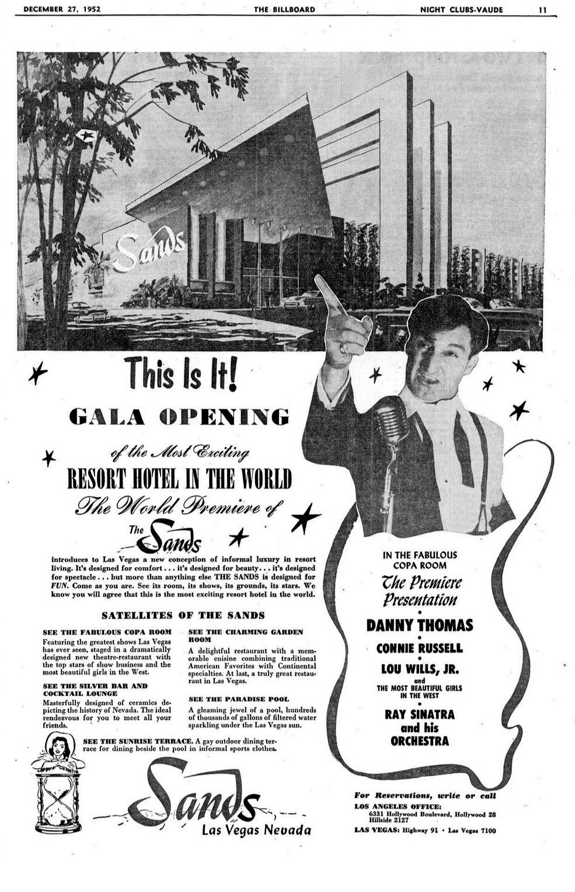
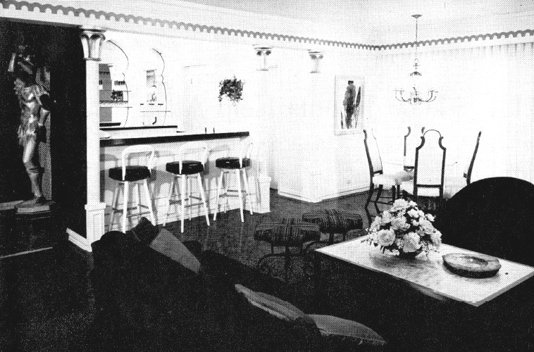
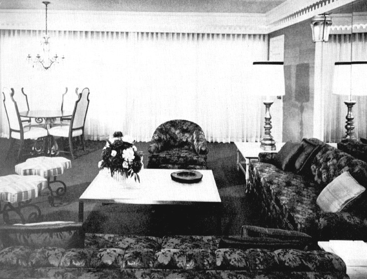

30 years ago today, November 26, 1996, the historic Sands Hotel and Casino was imploded on the Las Vegas Strip. The controlled blast brought down a legendary resort to clear room for The Venetian, ending a defining era of mid-century American entertainment.

## The Fall of a Desert Landmark

On November 26, 1996, a cloud of dust marked the end of an icon along Las Vegas Boulevard. The Sands Hotel and Casino, located in the unincorporated town of Paradise, Nevada, was reduced to rubble. Final owner Sheldon Adelson, having bought out his partners, chose to clear the site entirely to construct a brand new megaresort. For generations of visitors, the site had represented the peak of classic desert nightlife.

## From a Sand-Filled Sock to Strip Royalty

The story began when Billy Wilkerson established the LaRue Restaurant in December 1950. Mack Kufferman bought the restaurant the following year with plans to construct a casino hotel, but failed to secure a gaming license. The shares were acquired by Jake Freedman, with financial backing connected to organized crime figures Meyer Lansky and Doc Stacher, who held interests across early Las Vegas.

Architect Wayne McAllister designed the property, and Los Angeles-based Trousdale Construction Company handled building operations. Freedman initially considered naming the hotel Holiday Inn after the film starring Bing Crosby. However, after walking the desert grounds and finding his socks full of sand, he chose the name Sands instead. Its promotional tagline became 'A Place in the Sun,' borrowed from the Montgomery Clift and Elizabeth Taylor film.

*NOT FROM THE EVENT · 1952 — Photo: Sands Hotel, Las Vegas / Public domain*

## A Wild Opening Night in 1952

The Sands opened on December 15, 1952, featuring 200 rooms divided into four two-story motel wings named after famous race tracks, with fifty rooms each. It stood as the seventh resort to open along the Strip, arriving less than three months after the Sahara Hotel and Casino. Its entrance boasted a prominent 56-foot sign that caught the eyes of travelers on Highway 91.

Opening night became instant desert lore. Some 12,000 visitors packed the resort within a few hours, accompanied by 146 journalists. Guests like Terry Moore, Esther Williams, Arlene Dahl, and Fernando Lamas attended the festivities. Every visitor received a chamois bag filled with silver dollars, and the casino ended up losing $200,000 in its first eight hours. Danny Thomas opened the Copa Room alongside Ray Sinatra and his Orchestra, though Thomas developed laryngitis on his second night.

*Sands suite living room Aqueduct building 1963 — Photo: [Clissold Businesspapers / Public domain*

## The Rat Pack Era and the Copa Room

The Sands grew into a cultural powerhouse after Frank Sinatra made his performance debut there in October 1953. Sinatra soon purchased an ownership share, making the resort his personal playground. The world-renowned Copa Room hosted regular showcases by Sinatra, Dean Martin, Sammy Davis Jr., Jerry Lewis, and Red Skelton.

In 1960, Hollywood cemented the resort's status by filming the classic caper movie Ocean's 11 inside the hotel. The Sands came to represent the Rat Pack aesthetic: sharp suits, silver dollars, and smooth desert jazz. In 1966, the resort expanded further with the addition of a 500-room tower.

*Sands suite living room 2 Aqueduct building 1963 — Photo: Clissold Businesspapers / Public domain*

## Changing Hands from Hughes to Adelson

In 1967, industrialist Howard Hughes bought the Sands, making it the first of several Las Vegas resorts he acquired. Over time, ownership passed to Sheldon Adelson, Richard Katzeff, Ted Bernard, Irwin Chafetz, and Jordan Shapiro. By the 1990s, the resort was facing competition from a new generation of massive casino properties on the 4.2-mile Strip.

Adelson bought out his business partners and shut the Sands down permanently. Rather than remodel the mid-century motel wings, he prepared the acreage for an entirely new vision. The property was slated to become The Venetian, an Italian-inspired luxury destination that would redefine modern resort architecture.

## The Legacy Left in the Dust

When the explosives detonated on November 26, 1996, thousands gathered along Las Vegas Boulevard to witness the building crumble. While the physical structure was gone, the legacy of the Sands lived on in American pop culture. The Venetian eventually opened in its place, but the memory of Sinatra and his friends taking the Copa Room stage remains an enduring symbol of vintage Las Vegas.

### Sources

- <https://en.wikipedia.org/wiki/Las_Vegas_Strip>
- <https://commons.wikimedia.org/wiki/File:The_Sands_Hotel_and_Casino_in_1959.jpg>
- <https://commons.wikimedia.org/wiki/File:Sands_opening_ad_Billboard_1952.jpg>
- <https://commons.wikimedia.org/wiki/File:Sands_suite_living_room_Aqueduct_building_1963.jpg>
- <https://commons.wikimedia.org/wiki/File:Sands_suite_living_room_2_Aqueduct_building_1963.jpg>
