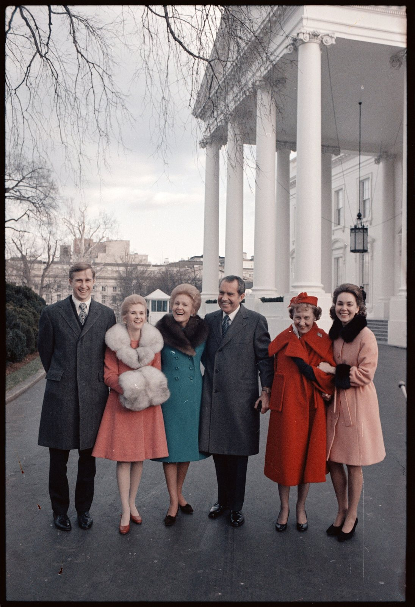
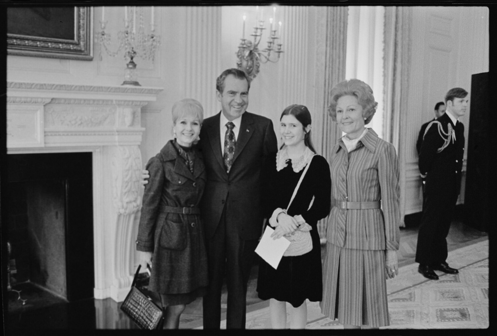
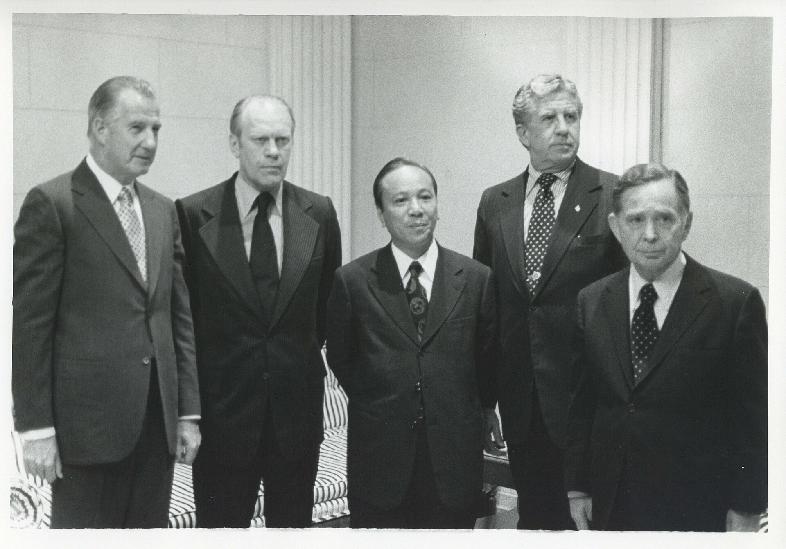

Fifty-three years ago today, November 27, 1973, the United States Senate took an unprecedented constitutional step. In a lopsided roll call of 92 to 3, senators voted to confirm Gerald R. Ford as Vice President of the United States. It was the first time in American history that an appointed vice president had been approved to fill a vacant office under the terms of the Twenty-fifth Amendment.

## A Sudden Vacancy in the Executive Branch

The crisis began in the autumn of 1973 when Vice President Spiro Agnew resigned his office. For much of American history, a vacancy in the vice presidency meant the position simply sat empty until the next quadrennial presidential election. Whenever a vice president died in office, resigned, or assumed the presidency after the death of the commander-in-chief, the nation carried on without a second-in-command, sometimes for years at a time.

## The Mechanism of the Twenty-fifth Amendment

The framework that governed Ford's appointment was relatively new. Submitted to the states by the 89th Congress on July 6, 1965, the Twenty-fifth Amendment was officially ratified on February 10, 1967, after reaching the required threshold of 38 states. Drafted with flexibility in mind under the guidance of principal draftsman John Feerick, the amendment addressed longstanding ambiguities surrounding presidential disability and succession.

While Section 1 made explicit that the vice president fully becomes president upon a vacancy in the highest office, Section 2 established the procedure for filling a void in the vice presidency. Under Section 2, the president nominates a replacement who takes office upon confirmation by a majority vote of both houses of Congress. Agnew's sudden departure provided the first real-world test for this constitutional provision.

*President Richard Nixon, Pat Nixon, Mamie Eisenhower, Julie Nixon Eisenhower, Tricia Nixon Cox and Ed Cox following the 1973 Inaugural Parade - DPLA - f27543abde482fd0e3eabc7e0069f401 — Photo: President (1969-1974 : Nixon). White House Photo Office. 196 / Public domain*

## The Selection of Gerald Ford

Faced with filling the vacancy during a period of mounting political turbulence, President Richard Nixon selected Gerald Rudolph Ford Jr. Born Leslie Lynch King Jr. in Omaha, Nebraska, and raised in Grand Rapids, Michigan, Ford had built a long and respected career in public service. He had been a star college athlete at the University of Michigan, winning two national football championships, before coaching football at Yale and earning his law degree from Yale Law School.

Following military service in the U.S. Naval Reserve from 1942 to 1946 during World War II, Ford entered national politics. He was elected to the House of Representatives in 1948 representing Michigan's 5th congressional district. By 1973, Ford had served nearly twenty-five years in the House, spending his final eight years as House minority leader. He had also served as a member of the Warren Commission investigating the assassination of President John F. Kennedy.

*President Richard Nixon and First Lady Pat Nixon with Actresses Debbie Reynolds and Carrie Fisher - DPLA - a80ba7ef45e4d2efd05adb1fec220a53 — Photo: President (1969-1974 : Nixon). White House Photo Office. 196 / Public domain*

## The Historic Senate Vote on November 27

Convening in the north wing of the Capitol Building, the 100-member Senate exercised its constitutional advice and consent powers under Article One. Because Ford was widely viewed on Capitol Hill as an honest and collegial lawmaker, his confirmation advanced smoothly despite the fierce partisan atmosphere surrounding the executive branch.

On November 27, 1973, the Senate cast its ballots. The final tally was an overwhelming 92 in favor and only 3 opposed. The decisive vote sent the nomination to the House of Representatives, which gave its own resounding approval on December 6, 1973, by a margin of 387 to 35. Gerald Ford was officially sworn in, securing the executive succession.

*Spiro T. Agnew, Gerald R. Ford, President Thieu of Vietnam, and Carl Albert posing for a picture. April 5, 1973 — Photo: Carl Albert Research and Studies Center, Congressional Colle / CC BY-SA 4.0*

## From Vice President to the Oval Office

Ford's tenure as vice president proved brief. In August 1974, amid the deepening Watergate scandal, President Nixon resigned the presidency. Invoking Section 1 of the Twenty-fifth Amendment, Ford immediately assumed the presidency as the nation's 38th chief executive, serving from 1974 until 1977.

Ford assumed leadership during an exceptionally challenging period, inheriting an economy facing the worst conditions in four decades since the Great Depression, marked by rising inflation and severe recession. The Senate's vote on this day in 1973 proved to be a decisive turning point, ensuring that the constitutional transfer of power remained orderly during one of the most tumultuous chapters in modern American governance.

### Sources

- <https://en.wikipedia.org/wiki/Twenty-fifth_Amendment_to_the_United_States_Constitution>
- <https://commons.wikimedia.org/wiki/File:House_Minority_leader_Gerald_Ford_letter_to_Richard_Nixon.jpg>
- <https://commons.wikimedia.org/wiki/File:President_Richard_Nixon,_Pat_Nixon,_Mamie_Eisenhower,_Julie_Nixon_Eisenhower,_Tricia_Nixon_Cox_and_Ed_Cox_following_the_1973_Inaugural_Parade_-_DPLA_-_f27543abde482fd0e3eabc7e0069f401.jpg>
- <https://commons.wikimedia.org/wiki/File:President_Richard_Nixon_and_First_Lady_Pat_Nixon_with_Actresses_Debbie_Reynolds_and_Carrie_Fisher_-_DPLA_-_a80ba7ef45e4d2efd05adb1fec220a53.jpg>
- <https://commons.wikimedia.org/wiki/File:Spiro_T._Agnew,_Gerald_R._Ford,_President_Thieu_of_Vietnam,_and_Carl_Albert_posing_for_a_picture._April_5,_1973.jpg>
