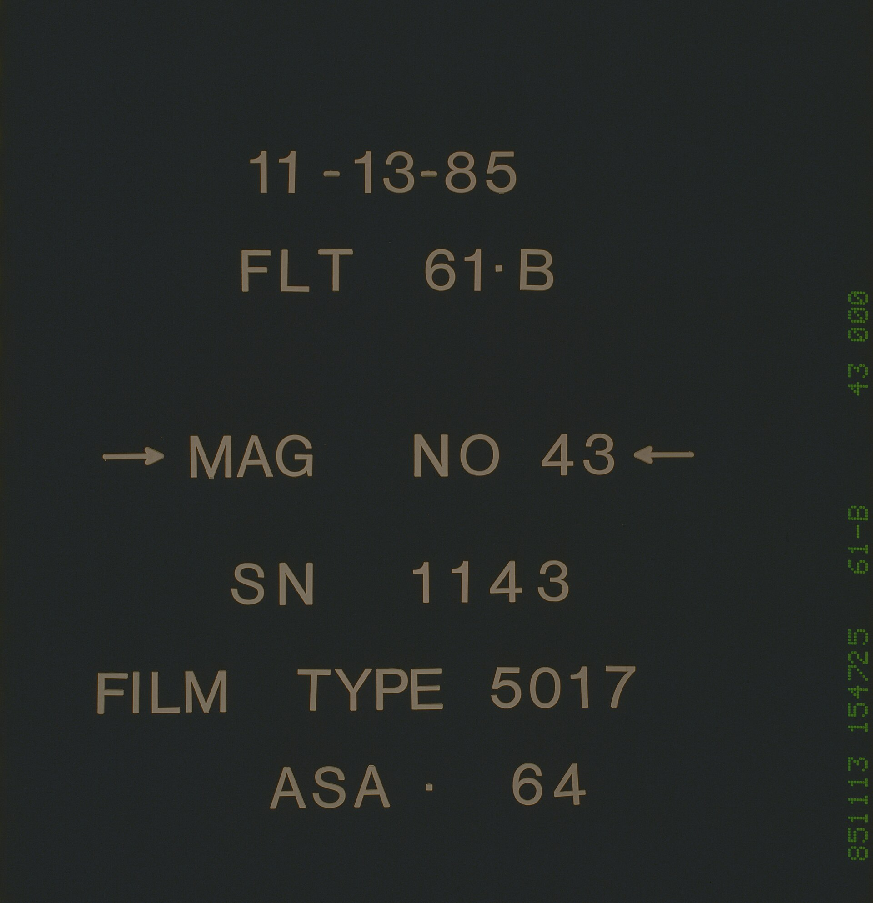
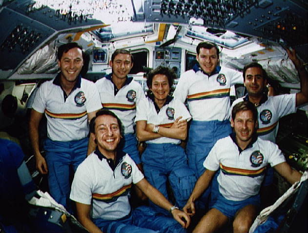
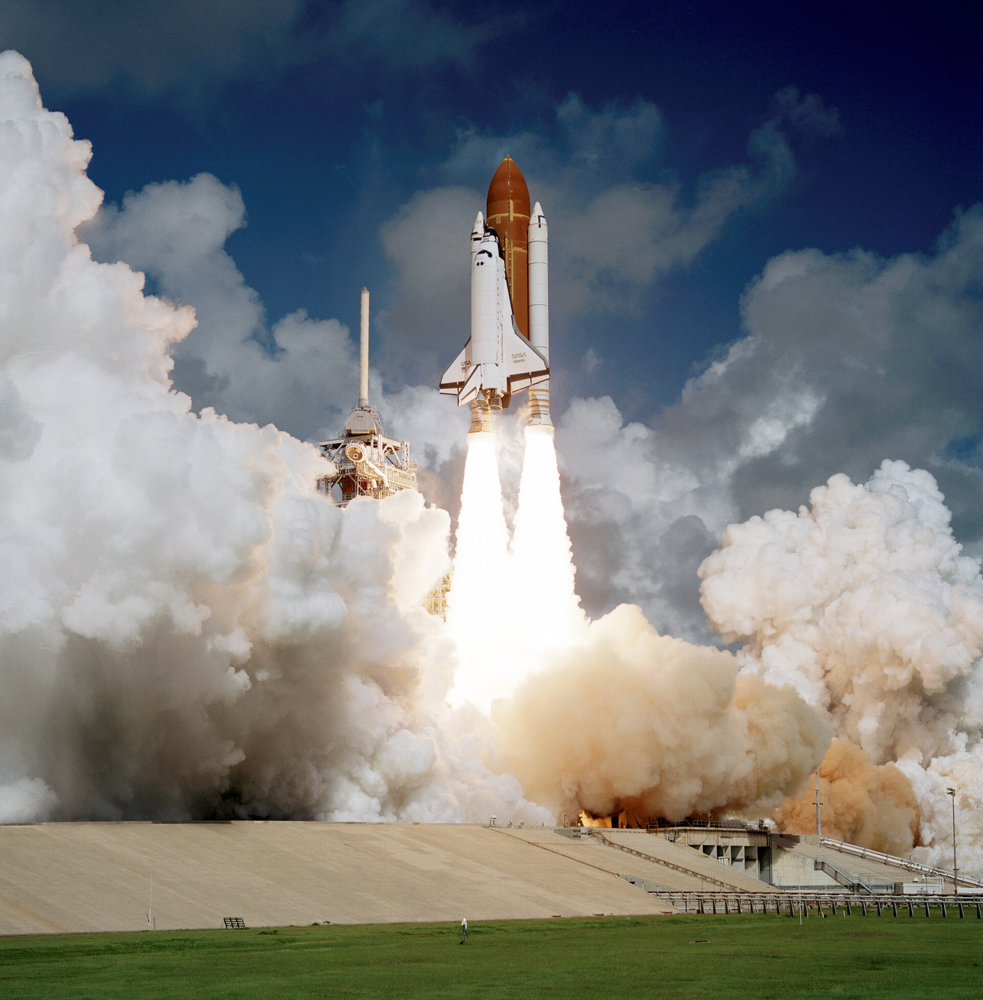

41 years ago today, November 27, 1985, Space Shuttle Atlantis lit up the Florida night sky as it launched on mission STS-61-B from the Kennedy Space Center. Aboard the orbiter was payload specialist Rodolfo Neri Vela, who made history by becoming the very first Mexican astronaut to fly in space.

## The Arrival of NASA's Newest Orbiter

Space Shuttle Atlantis, designated Orbiter Vehicle OV-104, was manufactured by Rockwell International in Southern California. Delivered to the Kennedy Space Center in Eastern Florida in April 1985, it stood as the fourth operational orbiter and the second-to-last shuttle ever built. Built in about half the time required for Columbia, Atlantis rolled out of the Palmdale assembly plant weighing 151,314 pounds, roughly 3.5 short tons lighter than its older sister ship. It was equipped to handle demanding missions and, alongside Challenger, was one of only two orbiters outfitted to carry the Shuttle-Centaur booster.

## A Historic First for Mexico

When STS-61-B lifted off on November 27, 1985, all eyes turned to payload specialist Rodolfo Neri Vela. His presence on the mission represented an international milestone as he became the first Mexican citizen to travel beyond Earth's atmosphere. The Space Shuttle program ultimately carried 355 astronauts from 16 different nations across its three decades of service, and Neri Vela's flight on STS-61-B expanded that international reach during a peak era of orbital spaceflight.

*61B-43-000 - STS-61B - DPLA - 16efe13e794d7dac75294c22d6d335c0 — Photo: National Aeronautics and Space Administration. Lyndon B. Joh / Public domain*

## A Record-Setting Turnaround in the Night Sky

The launch of STS-61-B was notable not only for its crew, but also for its technical achievement. It was only the second night launch conducted in the history of the Space Shuttle program. Even more extraordinary was the speed of the orbiter's processing. Atlantis had completed its maiden flight, STS-51-J, between October 3 and October 7, 1985. Launching again on November 27 meant that Atlantis returned to orbit a mere 50 days after concluding its previous flight. This turnaround time remained the shortest interval between missions for any orbiter throughout the entire history of the shuttle program.

*STS61B-21-008 — Photo: NASA / Public domain*

## The Evolution of the Reusable Space Truck

The Space Shuttle was conceived as part of the Space Transportation System, a vision formally initiated under a 1969 plan led by Vice President Spiro Agnew. Formally commenced in 1972, the program envisioned a reusable winged spacecraft capable of launching vertically, carrying up to 50,000 pounds of payload and up to eight crew members, and gliding back to Earth for a runway landing. While early plans projected over 150 launches over a 15-year operational lifespan, the fleet eventually flew 135 missions between 1981 and 2011, serving as humanity's primary reusable workhorse in low Earth orbit.

*Archive, 1985 — Photo: NASA / Public domain*

## Atlantis Across Three Decades of History

Following STS-61-B, Atlantis continued to compile one of the most storied flight logs in aerospace history. In 1989, it became the first Space Shuttle to deploy interplanetary probes, sending Magellan toward Venus on STS-30 and Galileo toward Jupiter on STS-34. Although a piece of insulation debris severely damaged over 700 tiles on mission STS-27 in 1988, the orbiter safely returned its crew. In total, Atlantis flew 33 operational missions and circled the globe 4,848 times, traveling nearly 126 million miles—a distance equivalent to more than 525 trips from Earth to the Moon.

## The Final Legacy of the Shuttle Fleet

Atlantis held the distinct honor of closing out the entire Space Shuttle program when it flew STS-135, touching down for the final time on July 21, 2011, before the program formally concluded that August. Today, the retired orbiter is preserved on public display at the Kennedy Space Center Visitor Complex in Florida, reminding visitors of the historic night in November 1985 when Atlantis carried Mexico's first astronaut into the stars.

### Sources

- <https://en.wikipedia.org/wiki/Space_Shuttle_Atlantis>
- <https://commons.wikimedia.org/wiki/File:STS-61-B_crew.jpg>
- <https://commons.wikimedia.org/wiki/File:61B-43-000_-_STS-61B_-_DPLA_-_16efe13e794d7dac75294c22d6d335c0.jpg>
- <https://commons.wikimedia.org/wiki/File:STS61B-21-008.jpg>
- <https://commons.wikimedia.org/wiki/File:STS51J_First_Flight_of_Atlantis.jpg>
