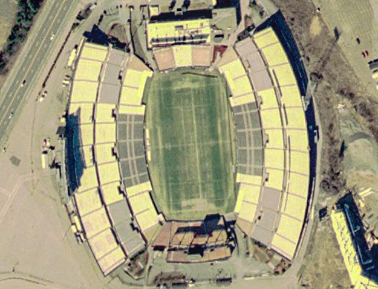
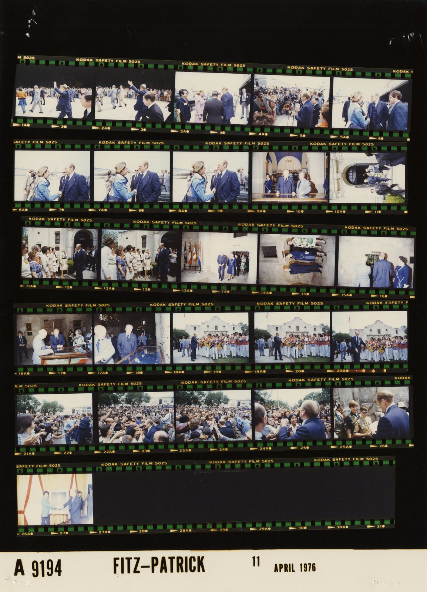
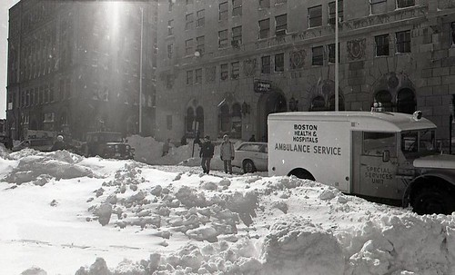

36 years ago today, November 27, 1990, the National Football League formally disciplined the New England Patriots franchise and three individual players for the sexual harassment of reporter Lisa Olson. The league's ruling concluded an investigation into an incident that exposed deep-seated resistance to female journalists working in professional sports.

## Lisa Olson and Her Rise in Boston Sports Journalism

Lisa Olson grew up in the Phoenix, Arizona area, surrounded by a family of dedicated sports fans. After attending Apollo and Shadow Mountain high schools, where she edited the student newspaper, she graduated with a degree in journalism from Northern Arizona University in 1985. Having served as the sports editor of her collegiate paper, Olson moved to the East Coast to pursue graduate studies, but she soon decided to seek work directly in professional sportswriting.

Her persistence was clear from the start. After finding herself unable to get past security at the Boston Globe, Olson walked unannounced into the offices of the Boston Herald to ask an editor for an opportunity. The Herald gave her an entry-level assignment handling horse-racing agate. Her sharp work quickly impressed supervisors, leading the newspaper to hire her as a full-time sports reporter. She earned major beats, covering the National Hockey League's Boston Bruins, the 1990 Super Bowl, and, by the fall of 1990, the NFL's New England Patriots.

## The Fight for Equal Locker Room Access

The environment Olson entered was shaped by decades of institutional exclusion. Beginning in the 1970s, as a growing wave of women sought careers in sportswriting, female reporters routinely encountered open hostility, intimidation, and discrimination from players, coaches, and sports executives. For years, women were barred from entering post-game locker rooms, putting them at a severe disadvantage when competing for quotes and breaking game stories.

That barrier was officially broken in 1978, when a landmark federal court decision mandated equal access to locker rooms for accredited female journalists. In 1985, the NFL enacted an official equal access policy of its own, requiring all member clubs to provide female media members the exact same working access afforded to men. Despite the clear rules on paper, professional football locker rooms often remained hostile environments where compliance was grudging.

*Archive, 1988 — Photo: Originally from fr.wikipedia; description page is (was) here / CC BY-SA 4.0*

## The Incident at the Patriots Locker Room

Tensions exploded into public view on September 17, 1990. On that day, Olson was inside the New England Patriots locker room at their facility to conduct routine player interviews during a regular practice day. Prior to the incident, two Patriots players had complained about her presence to James Oldham, the team's director of media relations.

While Olson attempted to conduct her interviews, members of the team subjected her to crude and hostile sexual harassment. Rather than backing down or remaining silent, Olson brought the unacceptable treatment to the attention of her editors and the public. The episode ignited immediate controversy across the country, highlighting the vast gap between league policy and the day-to-day reality endured by female sports journalists.

*Ford A9194 NLGRF photo contact sheet (1976-04-09)(Gerald Ford Library) — Photo: White House Photographic Office (WHPO) - Fitz-Patrick / Public domain*

## The League Investigation and the Fines of November 27

Faced with national scrutiny, Olson initiated legal action by suing the New England Patriots franchise. In response, the National Football League launched its own internal investigation to examine the actions of the players and the club's front office.

The inquiry culminated on November 27, 1990. The league announced that it was imposing official fines against the New England Patriots organization as well as three individual players directly implicated in the harassment. The ruling affirmed that the players and the team had violated league standards and breached the NFL's policy guaranteeing equal access and a professional working environment for working journalists.

*Boston Police Headquarters on Berkeley Street — Photo: Boston City Archives / CC BY-SA 2.0*

## The Aftermath and Olson's Historic Global Career

Although Olson eventually reached a settlement in her civil suit against the Patriots, the backlash from football supporters was intense. Following the league's penalties, hostile fans directed severe threats against Olson's life. Recognizing the danger, the Boston Herald offered to transfer her overseas to Australia, an assignment Olson accepted.

Working for the Daily Telegraph in Sydney, Olson quickly became a groundbreaking voice on the other side of the world. She went on to become the first female sports columnist for the Sydney Morning Herald, covering major sports including rugby union, Australian rules football, rugby league, and cricket. Her international career expanded as she reported from Australia, New Zealand, Japan, China, Afghanistan, Pakistan, and South Africa.

## A Watershed Legacy in Professional Sports

Olson eventually returned to American sports coverage, serving as a prominent sports columnist for the New York Daily News and AOL's FanHouse website. She broke another historical barrier by becoming the first woman in the 120-year history of The Sporting News to pen the publication's monthly back page. In addition to being featured in 'The Best American Sports Writing' anthology, she joined the Baseball Writers' Association of America and became an official voter for the Baseball Hall of Fame.

The penalties announced on November 27, 1990, stand as a crucial turning point in sports history. The league's public condemnation of the New England Patriots established a vital precedent, demonstrating that harassment in professional locker rooms would carry real disciplinary consequences and cementing equal professional dignity for female sportswriters.

### Sources

- <https://en.wikipedia.org/wiki/National_Football_League>
- <https://commons.wikimedia.org/wiki/File:USMC-05531.jpg>
- <https://commons.wikimedia.org/wiki/File:Foxborostade_crop_1.png>
- <https://commons.wikimedia.org/wiki/File:Ford_A9194_NLGRF_photo_contact_sheet_(1976-04-09)(Gerald_Ford_Library).jpg>
- <https://www.flickr.com/photos/48039697@N05/16348260756>
