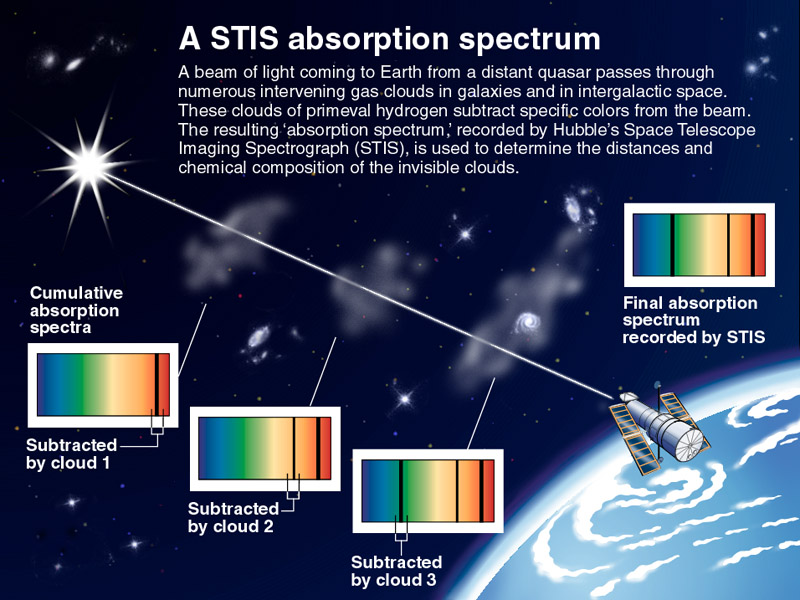
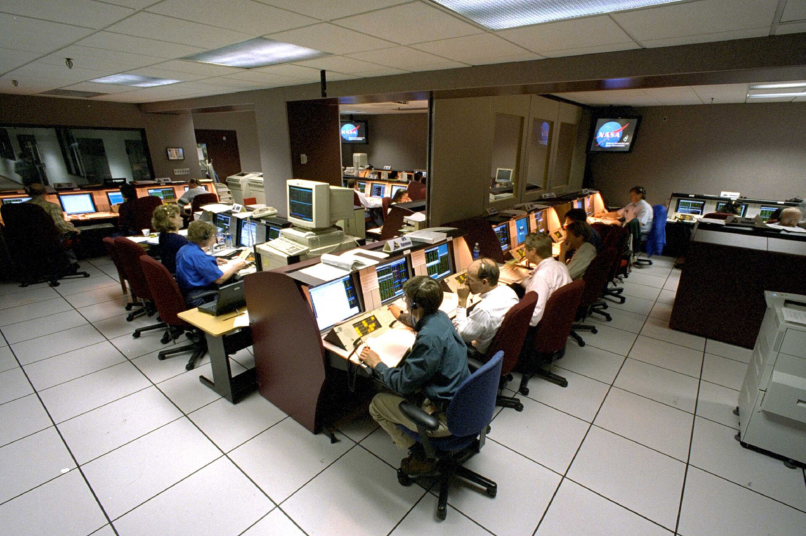
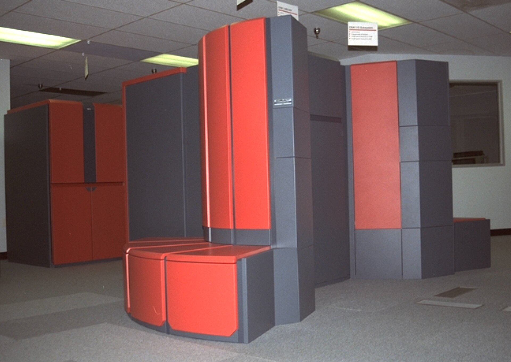

25 years ago today, November 27, 2001, the Hubble Space Telescope detected a hydrogen atmosphere on the extrasolar planet Osiris. It was the very first atmosphere ever discovered on a planet beyond our solar system, proving that distant worlds could retain gas envelopes under the pull of their own gravity.

## A Historic First Beyond Our Solar System

Before late 2001, every atmosphere ever analyzed by human science belonged strictly to the planets, moons, and dwarf planets within our own solar neighborhood. Aside from Mercury, the planets orbiting our Sun maintain substantial gaseous envelopes, ranging from the nitrogen- and oxygen-rich atmosphere of Earth to the massive hydrogen- and helium-dominated envelopes of gas giants like Jupiter. However, confirming whether planets orbiting other stars—known as extrasolar planets or exoplanets—could hold onto similar layers of gas was an open scientific question. On November 27, 2001, that barrier was broken when the Hubble Space Telescope confirmed the presence of a hydrogen atmosphere on the extrasolar planet Osiris.

## The Science of an Astronomical Atmosphere

An atmosphere is defined as a layer of gases that envelops an astronomical object, held securely in place by the object's gravity. The term itself traces back to the Ancient Greek words atmos, meaning vapour or steam, and sphaira, meaning sphere. In planetary science, an object acquires most of its atmosphere during its primordial epoch, either through the accretion of matter from a circumstellar nebula or through the outgassing of volatiles. A celestial body can retain its atmosphere for far longer durations when its surface gravity is high and its temperature is low. Conversely, stellar wind from a host star continuously works to strip away outer atmospheric layers, a relentless erosion process that can be slowed if the body possesses a protective magnetosphere.

*Archive, 1998 — Photo: NASA/STScI / Public domain*

## Detecting Hydrogen, the Universe's Most Abundant Element

The gas identified around Osiris was hydrogen, the simplest and lightest chemical element with atomic number 1. Hydrogen accounts for approximately 75 percent of all normal matter in the universe. First identified as a distinct substance by Henry Cavendish between 1766 and 1781, hydrogen was given a name meaning 'water-former' after Cavendish observed that it produces water when burned. Under standard conditions, it exists as a diatomic gas, colorless, odorless, and highly combustible. Because hydrogen atoms absorb and emit light at specific, well-defined spectral wavelengths—such as ultraviolet transitions linked to its ground-state energy level—astronomers can recognize its distinct spectroscopic signature across vast interstellar distances.

*Archive, 1999 — Photo: http://www.hubblesite.org/ / Public domain*

## Hubble's Unmatched View from Orbit

This discovery was made possible by the unique capabilities of the Hubble Space Telescope. The concept of an extraterrestrial observatory had been championed as early as 1923 by rocketry pioneer Hermann Oberth and detailed in 1946 by astronomer Lyman Spitzer. Spitzer pointed out two critical advantages of placing a telescope above Earth's atmosphere: the angular resolution would not be degraded by atmospheric turbulence—the effect known as 'seeing' that causes stars to twinkle—and the observatory could detect ultraviolet and infrared wavelengths that are otherwise strongly absorbed by Earth's air. Brought to reality through decades of work by NASA and key leaders like Nancy Grace Roman, the 'Mother of Hubble', the spacecraft was launched into low Earth orbit in 1990 aboard Space Shuttle Discovery on mission STS-31.

*Cray Y-MP GSFC — Photo: Dave Pape / Public domain*

## Overcoming Early Flaws to Deliver Breakthroughs

Hubble's journey to this landmark detection was not without severe challenges. Soon after its 1990 launch, engineers discovered that the primary 2.4-meter mirror had been ground incorrectly, suffering from spherical aberration that compromised optical clarity. Because Hubble was specifically designed to be serviced in orbit by astronauts, the STS-61 shuttle mission in 1993 successfully installed corrective optics. Operating with five main instruments sensitive across the ultraviolet, visible, and near-infrared bands, Hubble went on to revolutionize astrophysics, from calculating the expansion rate of the universe to scrutinizing exoplanets like Osiris and HD 209458 b.

## The Enduring Legacy of Exoplanet Exploration

The 2001 detection on Osiris marked the opening chapter of atmospheric characterization for alien worlds, turning exoplanet study from simple orbital detection into detailed chemical analysis. Hubble has now operated for more than three decades, outliving its initial expectations through five astronaut servicing missions. While successors such as the James Webb Space Telescope and the Nancy Grace Roman Space Telescope continue expanding this scientific frontier, Hubble's historic 2001 confirmation of Osiris's hydrogen shroud remains one of the greatest observational milestones in modern astronomy.

### Sources

- <https://en.wikipedia.org/wiki/Atmosphere>
- <https://commons.wikimedia.org/wiki/File:Horsehead-Hubble.jpg>
- <https://commons.wikimedia.org/wiki/File:Cumulative-absorption-spectrum-hubble-telescope.jpg>
- <https://commons.wikimedia.org/wiki/File:Hubble_Control_Centre.jpg>
- <https://commons.wikimedia.org/wiki/File:Cray_Y-MP_GSFC.jpg>
