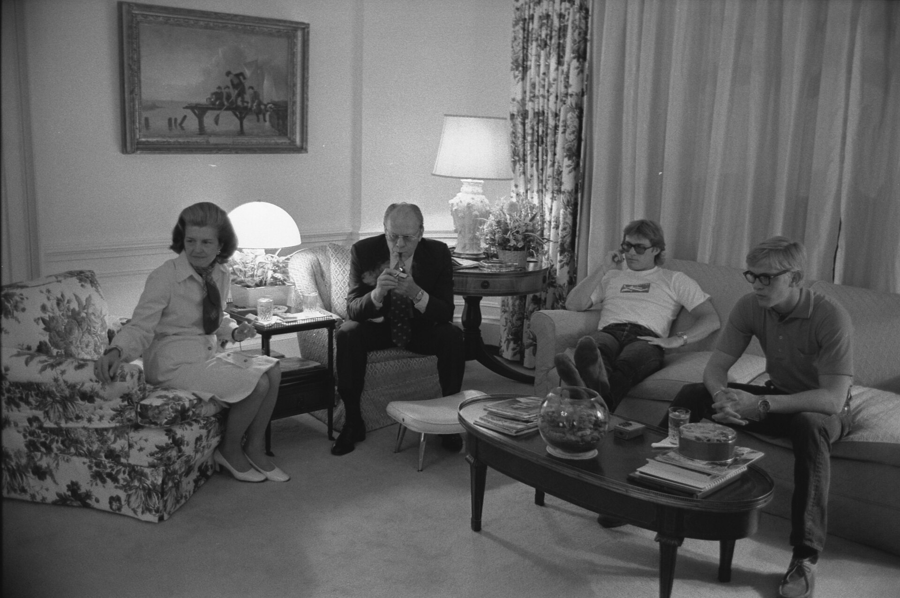

24 years ago today, November 27, 2002, Walt Disney Pictures officially brought its 43rd full-length animated feature, Treasure Planet, to theaters across the United States. Conceived as a grand science fiction reimagining of Robert Louis Stevenson's classic 1883 adventure novel Treasure Island, the film represented one of the most technically ambitious projects ever attempted by Walt Disney Feature Animation.

## A Concept Born During the Disney Renaissance

The creative journey behind Treasure Planet began well before its Thanksgiving release date in 2002. Filmmaking partners John Musker and Ron Clements originally pitched the concept of setting Stevenson's seafaring pirate story in outer space all the way back in 1989, while they were completing work on The Little Mermaid. Although Disney management initially placed the idea on hold, the directing duo persisted through years of other landmark studio productions. Full development finally got underway after Musker and Clements finished their work directing Hercules in 1997.

## The Most Expensive Traditionally Animated Movie Ever Made

Bringing space galleons powered by solar sails to life demanded an unprecedented financial and artistic commitment. Treasure Planet carried an enormous production budget of 140 million dollars, establishing it as the most expensive traditionally animated motion picture to date. To realize its futuristic yet archaic universe, animators employed an innovative hybrid technique that set hand-drawn two-dimensional character animation atop fully rendered three-dimensional computer graphics. The production showcased this visual approach through vessels resembling eighteenth-century sailing ships navigating stellar nebulae, supernovas, and black holes.

*Ford family watches Sacramento assassination attempt news coverage image A6332-04 — Photo: David Hume Kennerly / Public domain*

## A Historic Dual Release on Standard and IMAX Screens

Disney organized a landmark distribution rollout to highlight the film's sweeping visuals. Following its European premiere in Paris on November 6, 2002, the studio launched the movie across the United States on November 27. It made film distribution history by becoming the very first title to open simultaneously in conventional movie theaters and on large-format IMAX screens. The audio landscape was equally grand, featuring an orchestral score composed by James Newton Howard along with songs written and performed by John Rzeznik.

*Scene of the era (not a photo of this event) — Photo: John Kuehl / Public domain*

## An All-Star Cast of Voice Talent

The intergalactic journey of the RLS Legacy brought together a distinguished ensemble cast. Joseph Gordon-Levitt voiced the restless young protagonist Jim Hawkins, while Brian Murray provided the voice of the complex cyborg cook John Silver. The production also featured David Hyde Pierce as the eccentric astrophysicist Dr. Delbert Doppler, Emma Thompson as the sharp feline commander Captain Amelia, and Martin Short alongside Laurie Metcalf and Roscoe Lee Browne. In a bittersweet milestone, legendary actor Patrick McGoohan delivered his final screen performance voicing the doomed pirate Billy Bones.

*Scene of the era (not a photo of this event) — Photo: Onasill - Bill Badzo - 149 Million Views - Thank Y / Public domain (PDM) 1.0*

## Critical Praise and Box-Office Disappointment

Upon its theatrical debut, Treasure Planet was greeted with generally positive reviews from film critics, who applauded its imaginative world-building, breathtaking visual aesthetic, and father-son emotional core. The motion picture went on to receive an Academy Award nomination for Best Animated Feature at the 75th Academy Awards. However, the impressive artistic reception did not translate into financial success at the domestic and international box office. The movie gathered only 109.6 million dollars worldwide against its massive 140 million dollar budget, marking a rare and stark box-office failure for Disney's historic animation division.

## The Legacy of a Cult Classic

In the decades following its difficult theatrical run, Treasure Planet found a completely new life among animation enthusiasts and audiences at home. Viewers who grew up with the movie came to celebrate its courageous blending of hand-drawn craftsmanship with early digital cinematography, elevating the feature into a beloved cult classic. From its beginnings in the storyboard rooms of Burbank to its place in Disney studio history, the film stands as a bold testament to hand-drawn animation reaching fearlessly for the outer stars.

### Sources

- <https://en.wikipedia.org/wiki/Walt_Disney_Animation_Studios>
- <https://commons.wikimedia.org/wiki/File:Reagans_watching_1984_election_returns_C25663-10.jpg>
- <https://commons.wikimedia.org/wiki/File:Ford_family_watches_Sacramento_assassination_attempt_news_coverage_image_A6332-04.jpg>
- <https://commons.wikimedia.org/wiki/File:Crowd_with_Prairie_Marksman_inaugural_train_at_East_Peoria,_August_1980.jpg>
- <https://www.flickr.com/photos/7156765@N05/51590016958>
