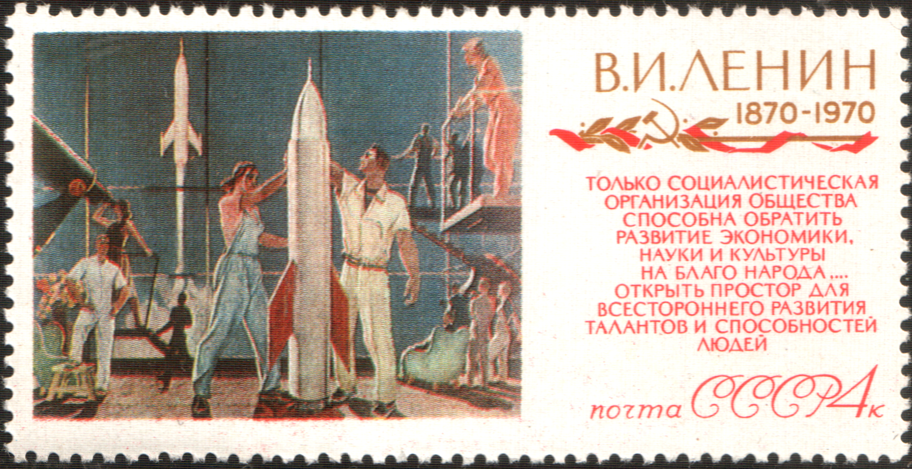
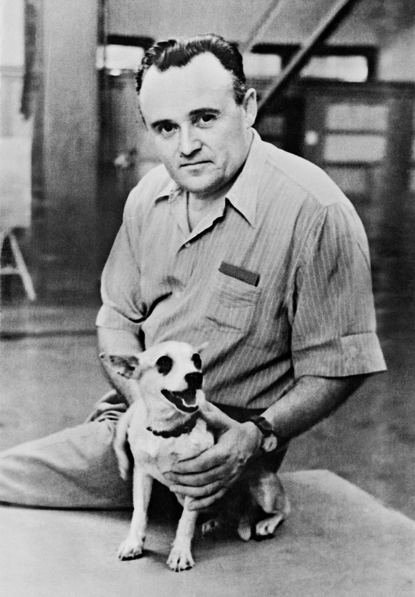

Fifty-five years ago today, on November 27, 1971, the Soviet Union's Mars 2 mission reached a dramatic climax. As its descent module separated from the main orbiter and plunged toward the Martian terrain, a critical malfunction sent the craft hurtling into the ground. Although destroyed on impact, the wreckage achieved an undeniable milestone: it was the first man-made object in human history to reach the surface of Mars.

## The Rivalry Behind the Cold War Space Race

From 1951 until the dissolution of the Soviet Union in 1991, the Soviet space program served as a crucial pillar of Moscow's claim to superpower status. While American space exploration was centralized under NASA, the Soviet effort was divided among several rival design bureaus. Prominent engineers and administrators including Korolev, Kerimov, Keldysh, Yangel, Glushko, Chelomey, Makeyev, Chertok, and Reshetnev competed for state resources, often coordinated under the Ministry of General Machine-Building.

This intense rivalry pushed Soviet engineers to accumulate groundbreaking space records. Following the theoretical foundation laid by Konstantin Tsiolkovsky and rocket tests beginning in the 1920s, the USSR achieved the first artificial satellite with Sputnik 1 in 1957, the first dog in orbit with Laika, the first human in space with Yuri Gagarin in 1961, and the first woman in space with Valentina Tereshkova. Beyond Earth orbit, the Luna program sent probes to impact and soft-land on the Moon, while the Venera series achieved the first planetary flybys and soft landings on Venus. The next major frontier was Mars.

## A String of Setbacks on the Road to Mars

Reaching Mars proved to be a far more punishing technical challenge than reaching Venus or the Moon. The Soviet Mars program began in 1960 with the Mars 1M series, dubbed 'Marsnik' in Western reporting. Both 650-kilogram probes failed to achieve Earth orbit. In 1962, Mars 1 managed to launch but failed en route, while companion spacecraft suffered upper-stage rocket malfunctions that stranded them in near-Earth space.

By 1969, Soviet planners escalated their ambition, transitioning from smaller Molniya rockets to the heavier Proton-K launch vehicle. They constructed massive five-ton spacecraft known as Mars 2M, but both attempts in 1969 were lost when their launch vehicles were destroyed during ascent. Soviet space hardware of this era struggled with reliability issues, yet the design bureaus pressed forward to prepare new hardware for the 1971 launch window.

*NOT FROM THE EVENT · 1970 — Photo: USSR Post / Public domain*

## Targeting the Perilous Red Planet

The target itself presented severe environmental extremes. Mars, the fourth planet from the Sun, is a desert world roughly half the diameter of Earth, measuring 6,779 kilometers across, with an overall surface area roughly equal to the dry landmass of Earth. Its surface gravity is only about one-third of Earth's.

Mars maintains a tenuous atmosphere composed primarily of carbon dioxide, with atmospheric pressure averaging only a few thousandths of that found on Earth. Temperatures range violently between minus 153 degrees Celsius and 20 degrees Celsius. With thin clouds, fog, frost, and polar permafrost caps, Mars held no open bodies of liquid surface water. Entering this wispy atmosphere required precise timing: too steep an angle would burn or smash the craft, while too shallow an entry would bounce it back into deep space.

*Sergey Korolev with dog — Photo: Музей космонавтики / Главархив Москвы / CC BY 4.0*

## November 27, 1971: The Impact of Mars 2

For the 1971 window, the Soviets deployed the Mars 4M design. Mars 2 was a combined spacecraft consisting of an orbital bus and an attached landing capsule. The orbiter was tasked with mapping the surface, measuring atmospheric composition, analyzing terrain temperatures, and monitoring the solar wind. The lander was designed to plunge through the atmosphere and reach the ground intact.

On November 27, 1971, as Mars 2 neared its target, the orbiter successfully released the descent module. However, during the approach and entry sequence, a malfunction crippled the lander's descent systems. The braking mechanisms failed to deploy properly. The module hurtled uncontrollably through the thin Martian air and crashed onto the barren red soil, ending all data transmission immediately upon impact.

*History of conservs in Moscow 01 — Photo: Главархив Москвы / CC BY 4.0*

## A Pioneer's Mark on Another World

Despite the destructive crash, the Mars 2 descent module entered the record books. It was the very first physical piece of human engineering to reach the surface of Mars, beating all other competitors to the Martian soil. The companion orbiter remained operational above, sending back data about the planet's atmospheric properties, topography, and temperature.

The mission represented both the tremendous hazards and the audacious reach of Cold War planetary exploration. While the descent module lay silent on the desert plains, the impact proved that human machinery could cross hundreds of millions of kilometers of interplanetary space and strike the surface of the Red Planet.

### Sources

- <https://en.wikipedia.org/wiki/Soviet_space_program>
- <https://commons.wikimedia.org/wiki/File:First_Photo_from_the_Surface_of_the_Moon.jpg>
- <https://commons.wikimedia.org/wiki/File:The_Soviet_Union_1970_CPA_3850_stamp_(Conquerors_of_the_Space_(After_Aleksandr_Deyneka)).png>
- <https://commons.wikimedia.org/wiki/File:Sergey_Korolev_with_dog.jpg>
- <https://commons.wikimedia.org/wiki/File:History_of_conservs_in_Moscow_01.jpg>
