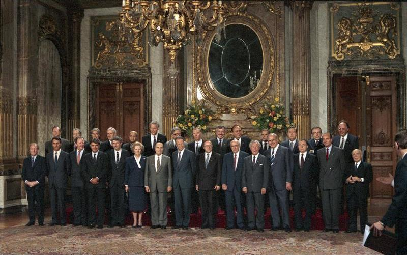
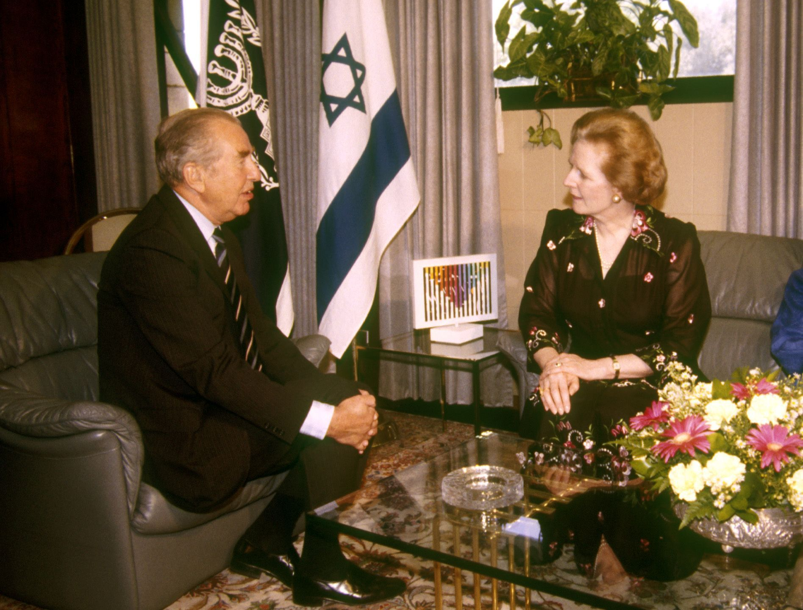
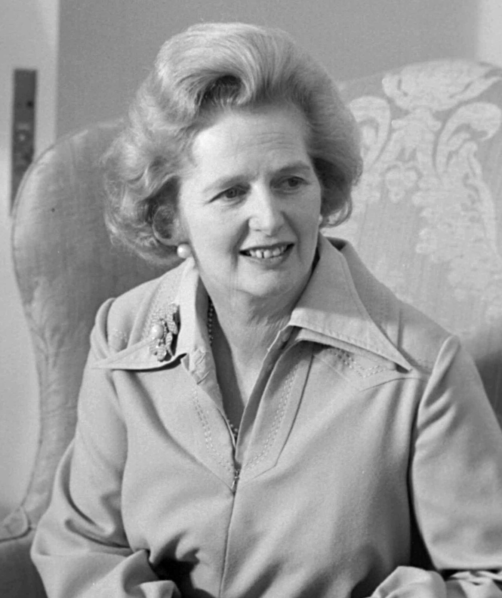

36 years ago today, November 28, 1990, British Prime Minister Margaret Thatcher stepped down from office. Her departure as leader of the Conservative Party and head of government brought to an end the longest premiership of the 20th century in Britain, clearing the way for her Chancellor of the Exchequer, John Major, to take her place.

## The Rise of Britain's First Female Prime Minister

Margaret Hilda Roberts entered Parliament in 1959 as the Member of Parliament for Finchley, having previously studied chemistry at Somerville College, Oxford, and trained as a barrister. After serving as Secretary of State for Education and Science under Edward Heath between 1970 and 1974, she mounted a bold challenge against him. In 1975, she defeated Heath in the party leadership election, becoming the Leader of the Opposition and the first woman to ever head a major British political party.

Her defining breakthrough arrived in 1979. Following the industrial strife of the Winter of Discontent and the onset of economic stagnation, Thatcher led the Conservatives to general election victory. Entering 10 Downing Street as the first female prime minister in British history, she immediately embarked on a mission to rein in high inflation and curb the state's reach across the British economy.

## The Philosophy and Battles of Thatcherism

The policies she championed soon became widely known as Thatcherism. Her doctrine emphasized individual liberty, the privatization of state-owned enterprises, and strict limits on the power and legal standing of trade unions. Early in her tenure, soaring unemployment and a harsh recession strained her standing, but international and domestic confrontations quickly transformed her public image.

A Soviet journalist bestowed upon her the moniker 'Iron Lady,' a title reflecting her rigid determination and combative governance. Britain's military victory in the 1982 Falklands War, combined with signs of economic recovery, drove Thatcher to a landslide re-election victory in 1983. In October 1984, she survived an assassination attempt when the Provisional IRA carried out the Brighton hotel bombing during the Conservative Party Conference. That same year, her administration faced down the National Union of Mineworkers in the protracted 1984–85 miners' strike, securing a decisive political victory.

*Archive, 1987 — Photo: Arne Schambeck / CC BY-SA 3.0 de*

## Financial Deregulation and a Historic Third Term

Thatcher’s economic programme reached new milestones in 1986 with the deregulation of United Kingdom financial markets, an overhaul commonly referred to as the Big Bang. The move catalyzed a massive boom in the City of London and reinforced the party's shift toward free-market principles.

Voters rewarded this record in 1987, returning her to Downing Street with a second consecutive landslide victory. She had secured three general election triumphs in succession, establishing herself as an unassailable fixture on the world stage. However, the policies implemented during this third term would soon expose severe fractures within both the electorate and her own political party.

*Archive, 1986 — Photo: IPPA staff photographer / CC BY 4.0*

## Internal Revolt and the Final Days at Downing Street

The turning point began with Thatcher's introduction of the Community Charge, universally referred to as the poll tax. The flat-rate levy provoked widespread public hostility and civil disobedience across the country. Simultaneously, her increasingly vocal Eurosceptic stance regarding integration in the European Community sparked serious dissent among key senior ministers within her cabinet.

When a challenge to her leadership of the Conservative Party was launched in late 1990, Thatcher found her authority fatally weakened. Realizing she could no longer command the united confidence of her parliamentary colleagues, she formally announced her resignation. On November 28, 1990, she vacated the premiership she had held since May 1979, and John Major succeeded her as party leader and prime minister.

*Thatcher-loc — Photo: Marion S. Trikosko / Public domain*

## A Monumental Political Legacy

After leaving 10 Downing Street, Thatcher retired from the House of Commons in 1992 and was awarded a life peerage, granting her a seat in the House of Lords as Baroness Thatcher. She passed away at the age of 87 in 2013 after suffering a stroke at the Ritz Hotel in London.

Over her eleven uninterrupted years in office, Margaret Thatcher fundamentally altered Britain's economic landscape through market deregulation and privatisation. While she remained one of the most polarizing political figures in modern history, she remains consistently recognized among the most consequential prime ministers to have ever governed the United Kingdom.

### Sources

- <https://en.wikipedia.org/wiki/Prime_Minister_of_the_United_Kingdom>
- <https://commons.wikimedia.org/wiki/File:ThatcherProfile.JPG>
- <https://commons.wikimedia.org/wiki/File:Bundesarchiv_B_145_Bild-F075760-0010,_Br%C3%BCssel,_Sitzung_des_Europarates.jpg>
- <https://commons.wikimedia.org/wiki/File:Margaret_Thatcher_and_Chaim_Herzog_1986.jpg>
- <https://commons.wikimedia.org/wiki/File:Thatcher-loc.jpg>
