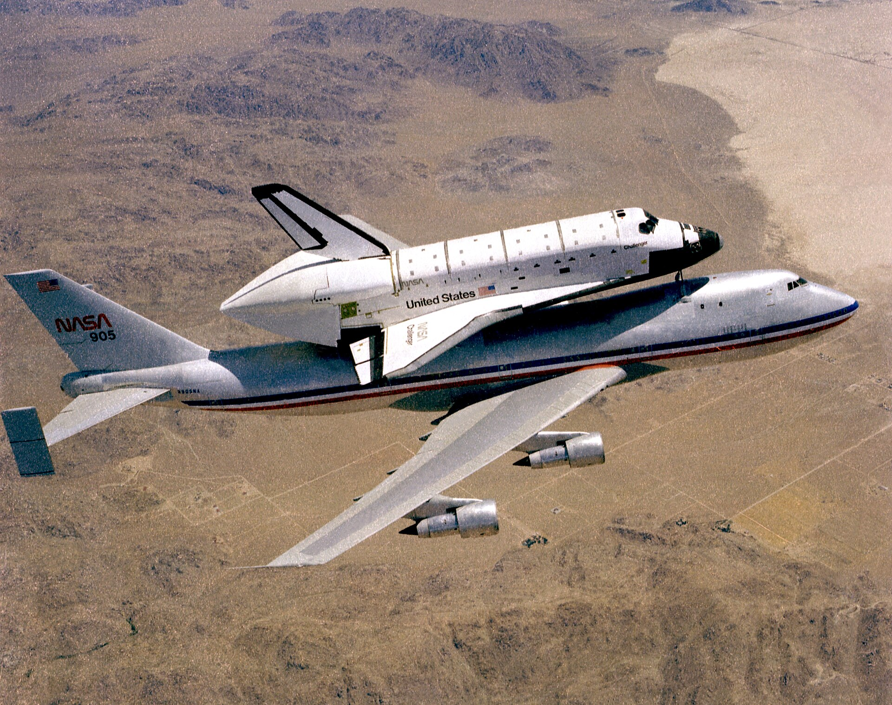
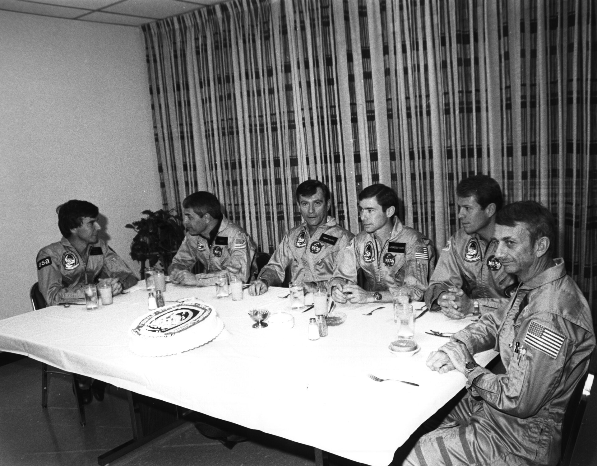
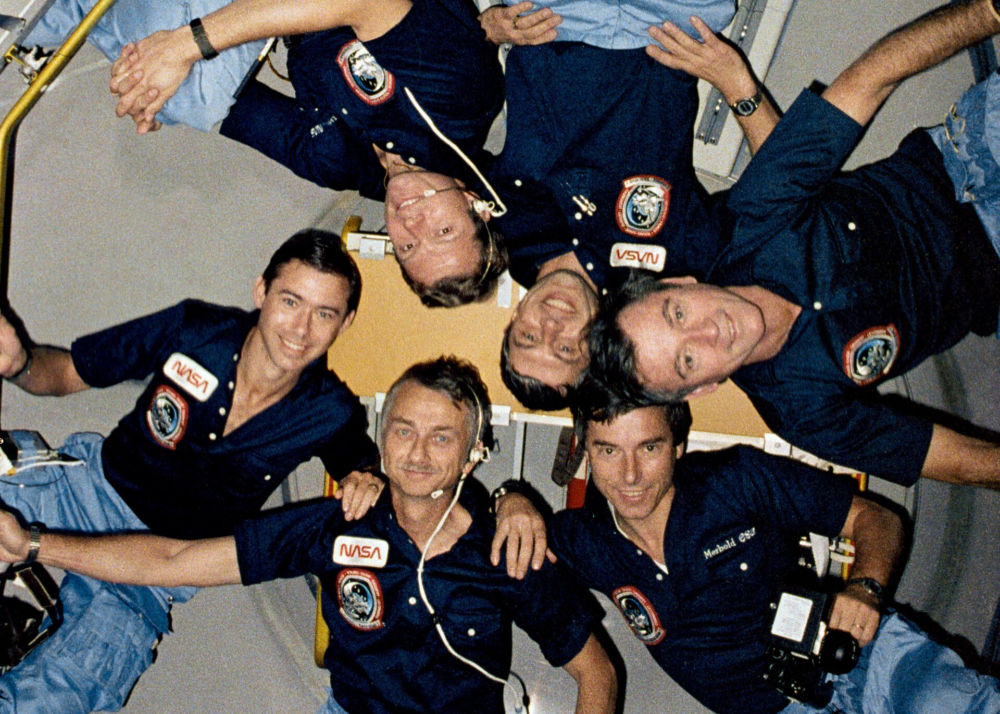

43 years ago today, November 28, 1983, Space Shuttle Columbia lifted off from Florida on mission STS-9. Tucked securely inside its cargo bay was Spacelab 1, marking the first time the European Space Agency's orbital laboratory took to the skies.

## A Laboratory Built for Orbit

By late 1983, NASA had already proven that its Space Shuttle fleet could reach orbit, deploy satellites, and return safely to a runway. However, the true promise of the shuttle program was to serve as a versatile orbital platform for ongoing scientific experimentation. To achieve that vision, NASA partnered with the European Space Agency (ESA), an organization founded in 1975 to integrate Western European space efforts. ESA funded and manufactured Spacelab, a modular research workshop engineered to fit snugly inside the shuttle's massive payload bay. Columbia, the fleet's flagship orbiter built by Rockwell International, was specially fitted with an internal tunnel connecting its crew cabin airlock directly to the science laboratory.

## Upgrading America's Heaviest Orbiter

Preparing Columbia for this groundbreaking flight required extensive technical modifications. Because Columbia was the first operational shuttle orbiter, it was inherently the heaviest of the fleet—roughly 1,000 kilograms heavier than Challenger and 3,600 kilograms heavier than Endeavour. To support a science mission of this scale, technicians installed higher-capacity fuel cells, a dedicated Ku-band antenna for continuous high-rate data relay, and upgraded main engines rated for 104 percent thrust. Inside the crew cabin, engineers added a galley and sleeping bunks to sustain the team throughout the planned ten-day mission.

*Archive, 1982 — Photo: NASA / Public domain*

## A Record-Breaking Six-Member Crew

STS-9 carried a crew of six astronauts, which was the largest crew ever launched on any single human space mission at that point in history. In the commander's seat sat John W. Young, one of NASA's most revered astronauts. Young was making his sixth and final spaceflight, concluding an 18-year career that included walking on the Moon during Apollo 16 and commanding Columbia's maiden voyage, STS-1, in 1981. He was joined by pilot Brewster H. Shaw, mission specialists Owen K. Garriott and Robert A. Parker, and payload specialists Byron K. Lichtenberg and Ulf Merbold. Garriott and Young made history as the only two pre-shuttle astronaut veterans to fly together on the same shuttle mission.

*STS-9 crew launch day breakfast — Photo: NASA / Public domain*

## Breaking Barriers with Ulf Merbold

Among the crew, West German physicist Ulf Merbold broke historic new ground. Merbold became the first non-U.S. citizen to fly aboard an American Space Shuttle, as well as the first European Space Agency astronaut to enter space. Together with Lichtenberg, a researcher from the Massachusetts Institute of Technology, Merbold worked directly inside the Spacelab module. The payload specialists coordinated their around-the-clock research with scientists at the Marshall Space Flight Center Payload Operations Control Center, which was then housed at the Johnson Space Center in Houston, Texas.

*Portrait of STS-9 crew in the Spacelab — Photo: NASA / Public domain*

## Ten Days of Groundbreaking Science

For ten days in orbit, the crew performed dozens of experiments spanning materials science, atmospheric physics, biology, and astronomy. Spacelab 1 demonstrated that complex laboratory work could be successfully performed in microgravity by non-career astronauts. The mission proved that the shuttle could operate not just as a transport vehicle, but as a fully functioning orbital outpost. Following its safe return, Columbia had logged another milestone, spending crucial days expanding humanity's understanding of living and working in low Earth orbit.

## The Foundation for International Cooperation

The success of STS-9 established a lasting precedent for transatlantic space cooperation. Columbia went on to fly eleven of the shuttle program's fifteen Spacelab missions over its 22-year operational career, remaining NASA's premier science workhorse. The operational workflows, international partnerships, and multinational crew dynamics pioneered during STS-9 laid the direct technical and managerial foundation for the International Space Station, proving that great nations could achieve far more in orbit together than apart.

### Sources

- <https://en.wikipedia.org/wiki/Space_Shuttle_Columbia>
- <https://commons.wikimedia.org/wiki/File:Shuttle-challenger.jpg>
- <https://commons.wikimedia.org/wiki/File:STS_Challenger_on_747_SCA.jpg>
- <https://commons.wikimedia.org/wiki/File:STS-9_crew_launch_day_breakfast.jpg>
- <https://commons.wikimedia.org/wiki/File:Portrait_of_STS-9_crew_in_the_Spacelab.jpg>
