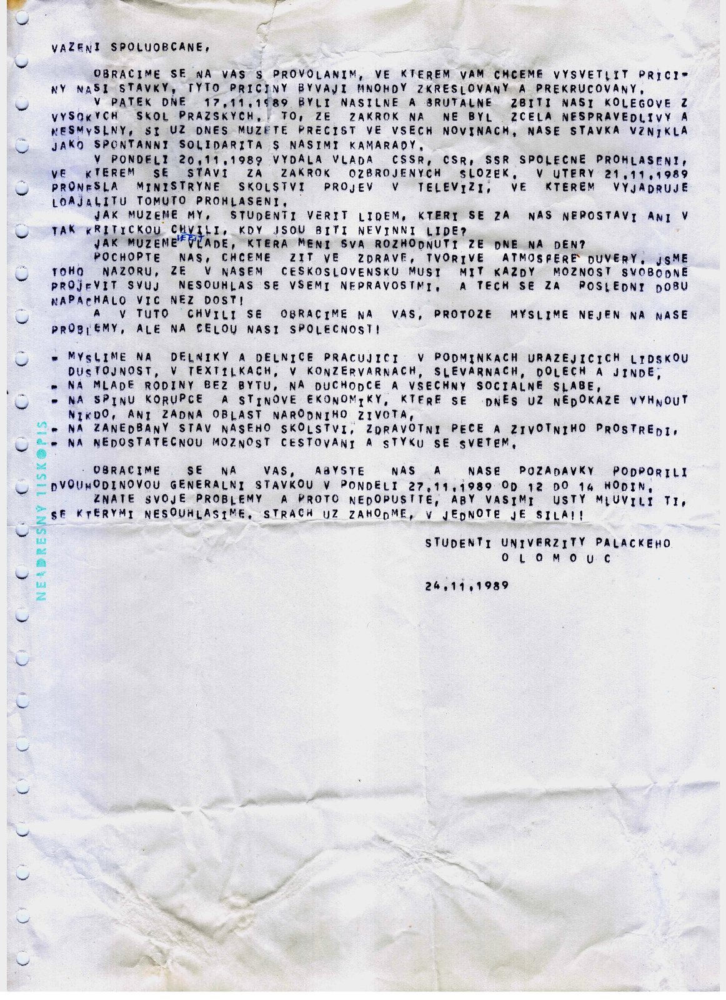
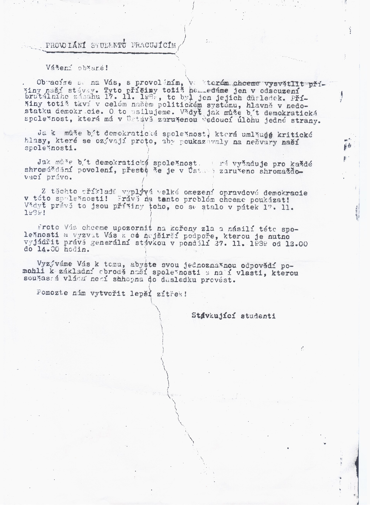
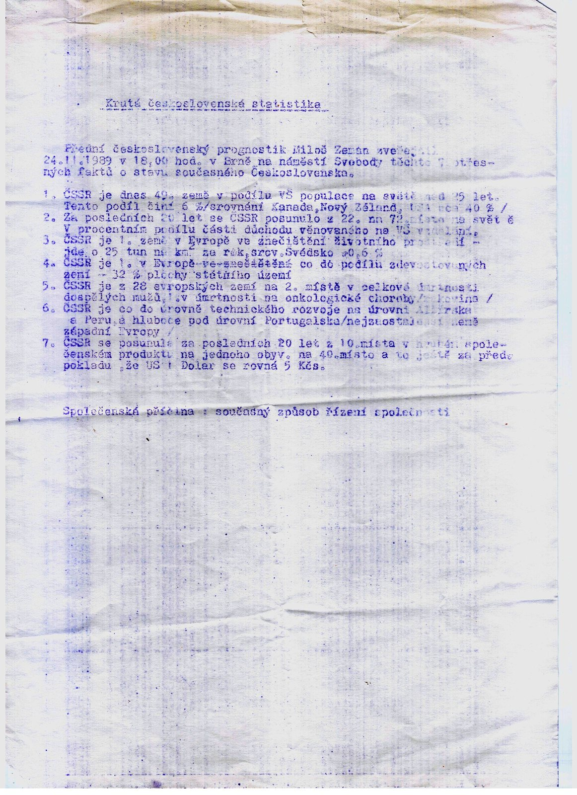

37 years ago today, November 28, 1989, the Communist Party of Czechoslovakia publicly conceded defeat. Facing relentless, non-violent mass protests that had paralyzed the nation, the ruling regime announced that it would relinquish its monopoly on political power, dismantling 41 years of authoritarian rule in Eastern Europe.

## Forty-One Years of One-Party Hegemony

The Communist Party of Czechoslovakia, founded in May 1921, had operated as a major political force throughout the interwar First Czechoslovak Republic. Although it won seats in parliament, it remained outside government until the aftermath of World War II. After emerging as the largest party in the free parliamentary election of 1946, the party and its leader Klement Gottwald staged a coup d'état in February 1948.

Following that seizure of power, the regime effectively eliminated free elections and political freedoms. Private enterprises were nationalized, and a planned command economy modeled after the Soviet Union was instituted. Although five minor non-communist parties formally existed within the so-called National Front coalition, they held no genuine authority. The communist apparatus retained absolute control over government policy, security forces, and public life for four straight decades.

## The Ghost of the 1968 Prague Spring

The regime's monopoly had been challenged before. In early 1968, reformers within the communist leadership led by Alexander Dubček initiated a period of political liberalization known as the Prague Spring. Dubček proposed democratic processes and sought to establish what he termed socialism with a human face.

Fearing that democratic reforms would destroy state socialism, the Soviet Union and its Warsaw Pact allies invaded Czechoslovakia on August 21, 1968, under the Brezhnev Doctrine. In 1969, Dubček was ousted and subsequently expelled from the party. Under Gustáv Husák, the regime carried out sweeping purges and reimposed hardline orthodoxy during a period known as normalization. For the next twenty years, open opposition was suppressed, and the communist party's rule appeared unbreakable.

*Samet-vyzva-univerzita-palackeho — Photo: Alpatron / CC BY-SA 4.0*

## Eleven Days That Shook Prague

The end of the regime began rapidly in the autumn of 1989 amid the collapse of other communist governments across the Eastern Bloc. On November 17, 1989, International Students' Day, university students held a demonstration in Prague to mark the 50th anniversary of Nazi suppression of Czech students in 1939. When riot police violently crushed the student march, public outrage boiled over.

Rather than intimidating the population, police brutality catalyzed widespread defiance. Protests erupted daily, drawing students, workers, and long-standing dissidents into the streets. By November 20, the crowd assembled in Prague surged from 200,000 on the prior day to an estimated 500,000 people. As the movement spread nationwide, the moral authority of the ruling party evaporated.

*Samet-vyzva-studenti — Photo: Alpatron / CC BY-SA 4.0*

## The Resignation and the General Strike

The rapid escalation left the regime's leadership paralyzed. On November 24, the entire top echelon of the Communist Party of Czechoslovakia, including General Secretary Miloš Jakeš, resigned from their posts. Yet the resignations failed to appease the public, which demanded systemic political change and free elections.

On November 27, millions of Czechoslovak citizens joined a two-hour general strike that brought the country to a standstill. The strike proved that workers, transport personnel, and urban professionals were united with the student movement and the opposition Civic Forum. The communist apparatus recognized that it had lost control of the state and possessed no means to reassert authority without catastrophic violence.

*Samet-ceskoslovenska-statistika — Photo: Alpatron / CC BY-SA 4.0*

## The Historic Capitulation of November 28

On November 28, 1989, the Communist Party formally bowed to popular pressure. The party announced to the nation that it would relinquish its monopoly on political power and allow the transition to a parliamentary republic. It was the decisive moment that guaranteed the success of what became known as the Velvet Revolution.

Two days later, on November 30, the federal parliament formally removed the constitutional provisions that had guaranteed the communist monopoly. By early December, border fortifications and barbed wire separating Czechoslovakia from West Germany and Austria were dismantled. On December 10, Gustáv Husák appointed the first largely non-communist government since 1948 and resigned the presidency. Alexander Dubček was elected speaker of the federal parliament on December 28, and playwright Václav Havel was elected president on December 29.

## The Cold War's Peaceful Turning Point

The peaceful capitulation on November 28 transformed the geopolitical landscape of Central Europe. In June 1990, Czechoslovakia conducted its first free and contested parliamentary elections since 1946, resulting in a decisive victory for the Civic Forum and the formal removal of the Communist Party from governance.

The peaceful nature of the 1989 transition set a precedent that endured through subsequent upheavals. On December 31, 1992, Czechoslovakia peacefully dissolved into two sovereign nations, the Czech Republic and the Slovak Republic. In 1993, the Czech Republic enacted legislation declaring the former communist regime illegal and criminal, cementing the legacy of the November 1989 revolution as a milestone in the global collapse of communist totalitarianism.

### Sources

- <https://en.wikipedia.org/wiki/Cold_War>
- <https://commons.wikimedia.org/wiki/File:Call_of_Czechoslovak_students_for_support_during_1989_velvet_revolution.jpg>
- <https://commons.wikimedia.org/wiki/File:Samet-vyzva-univerzita-palackeho.jpg>
- <https://commons.wikimedia.org/wiki/File:Samet-vyzva-studenti.jpg>
- <https://commons.wikimedia.org/wiki/File:Samet-ceskoslovenska-statistika.jpg>
