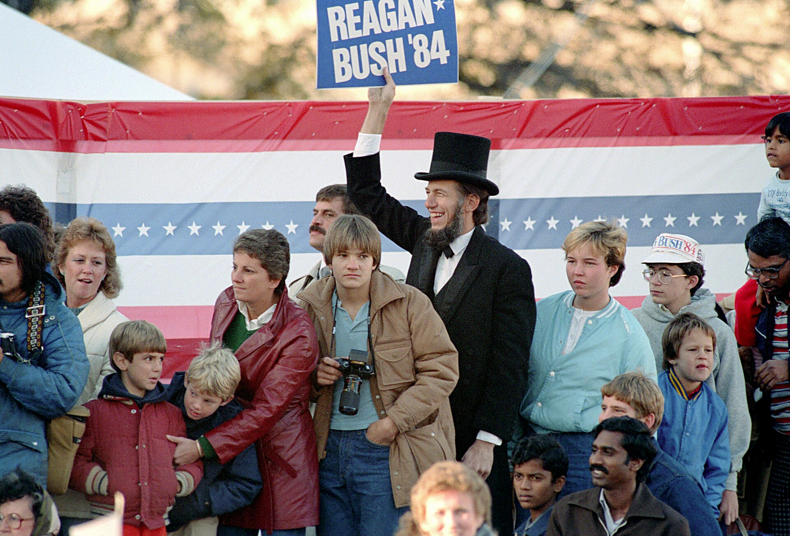
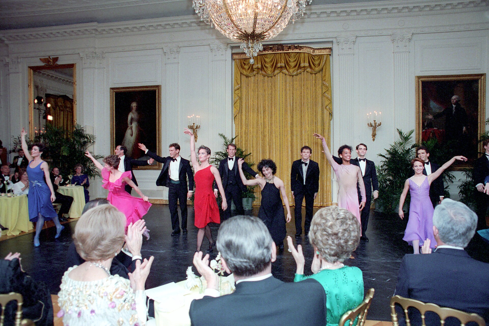
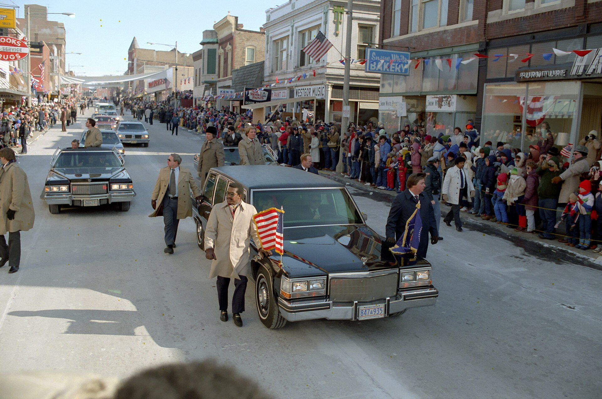

42 years ago today, November 28, 1984, William Penn and his wife Hannah Callowhill Penn were granted honorary citizenship of the United States by presidential proclamation. Over two and a half centuries after their deaths, the couple who laid the political and philosophical foundations of Pennsylvania finally received one of the rarest distinctions in American history.

## An Exclusive and Historic Distinction

Honorary United States citizenship is an exceptionally rare accolade reserved for individuals of extraordinary merit who were not born or naturalized American citizens. In all of United States history, only eight people have received this title. Among them, only Sir Winston Churchill and Mother Teresa received it during their lifetimes, while the remaining six received the honor posthumously.

When President Ronald Reagan issued the official proclamation on November 28, 1984, pursuant to Public Law 98-516 enacted by Congress, the act carried special historical weight. Hannah Callowhill Penn became the very first woman ever granted honorary United States citizenship, recognized alongside her husband for her foundational leadership.

## William Penn and the Holy Experiment

William Penn was born in London in 1644, the son of Admiral Sir William Penn. Despite his father's prominent military and social standing, young William broke away from conventional authority early in life. He embraced Quakerism, defended freedom of conscience, and suffered repeated imprisonments in the Tower of London for his nonconformist religious beliefs, penning his theological classic 'No Cross, No Crown' while imprisoned in 1669.

In 1681, King Charles II settled a substantial financial debt owed to Admiral Penn by granting his son an expansive territory in British North America, corresponding to modern-day Pennsylvania and Delaware. William Penn traveled across the Atlantic in 1682, founded Philadelphia on the western bank of the Delaware River, and established a society grounded in equality, representative governance, and peaceful, treaty-based relations with the local Lenape native people.

*During a Trip to Springfield Illinois at a Reagan Bush Rally - DPLA - a9a926deecbfea5364078d6505eb6c20 — Photo: President (1981-1989 : Reagan). White House Photographic Off / Public domain*

## Hannah Penn: The Unofficial Governor

Hannah Margaret Callowhill was born in Bristol, England, in 1671, the daughter of merchant Thomas Callowhill. In March 1696, the 25-year-old Quaker married the 52-year-old William Penn. Three years later, while pregnant with the first of their nine children, she crossed the Atlantic to make her home in Pennsylvania, living at Pennsbury Manor along the Delaware River.

Her defining test came in 1712, when William Penn suffered a succession of debilitating strokes that left him unable to conduct business. Hannah stepped into the breach, effectively administering the Province of Pennsylvania on his behalf for six years. Her resolute leadership ensured political stability during a precarious chapter in colonial governance.

*Entertainment By Twyla Tharp Dance Company in The East Room During The State Dinner for Grand Duke Jean of Luxembourg - DPLA - 3e096d1036c62821ae84a1bfe095f931 — Photo: President (1981-1989 : Reagan). White House Photographic Off / Public domain*

## Preserving the Colony After William's Death

When William Penn passed away on July 30, 1718, at the age of 73, his will placed full control of Pennsylvania and his estate into Hannah's hands. That arrangement immediately triggered fierce opposition from William Penn Jr., William's eldest son from his first marriage, who launched a legal battle to overturn his father's will and seize the proprietary governorship.

Hannah defended the estate and successfully defeated the lawsuit. Working alongside her deputy governor William Keith, she served as acting proprietor of Pennsylvania for another eight years until her death in December 1726 at age 55. She was laid to rest beside William in the Quaker burial ground at Jordans in Buckinghamshire, England.

*Limousine Motorcade Through Dixon Illinois - DPLA - 1da4f4fff924966c4a2edac02f7ac612 — Photo: President (1981-1989 : Reagan). White House Photographic Off / Public domain*

## Architects of the American Framework

The principles implemented by William and Hannah Penn had an enduring influence that stretched far beyond the borders of their colony. William had long advocated for the unification of the British colonies into a single political body. The democratic ideals embedded in the West Jersey Concessions and the Pennsylvania Frame of Government served as direct inspiration for the delegates who assembled in Philadelphia in 1787 to draft the United States Constitution.

Today, Hannah Penn's memory remains an active part of Pennsylvania's geography. When William laid out Philadelphia, he named Callowhill Street in her family's honor, giving rise to the modern Callowhill neighborhood, while schools and civic days across the Commonwealth continue to commemorate her leadership. The 1984 proclamation ensured that both William and Hannah Penn take their rightful place in the national story.

### Sources

- <https://en.wikipedia.org/wiki/William_Penn>
- <https://commons.wikimedia.org/wiki/File:Reagan_Contact_Sheet_C19266.jpg>
- <https://commons.wikimedia.org/wiki/File:During_a_Trip_to_Springfield_Illinois_at_a_Reagan_Bush_Rally_-_DPLA_-_a9a926deecbfea5364078d6505eb6c20.jpg>
- <https://commons.wikimedia.org/wiki/File:Entertainment_By_Twyla_Tharp_Dance_Company_in_The_East_Room_During_The_State_Dinner_for_Grand_Duke_Jean_of_Luxembourg_-_DPLA_-_3e096d1036c62821ae84a1bfe095f931.jpg>
- <https://commons.wikimedia.org/wiki/File:Limousine_Motorcade_Through_Dixon_Illinois_-_DPLA_-_1da4f4fff924966c4a2edac02f7ac612.jpg>
