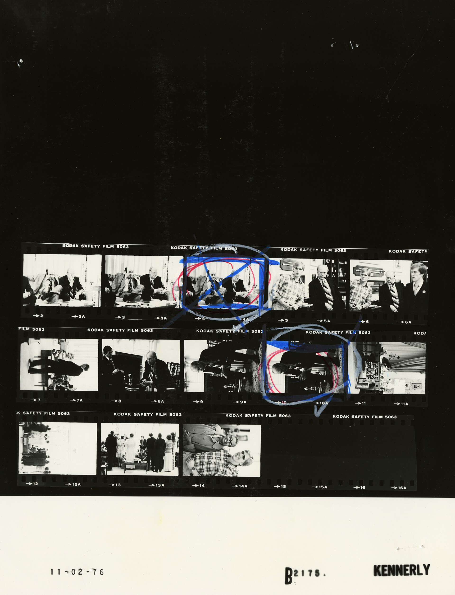
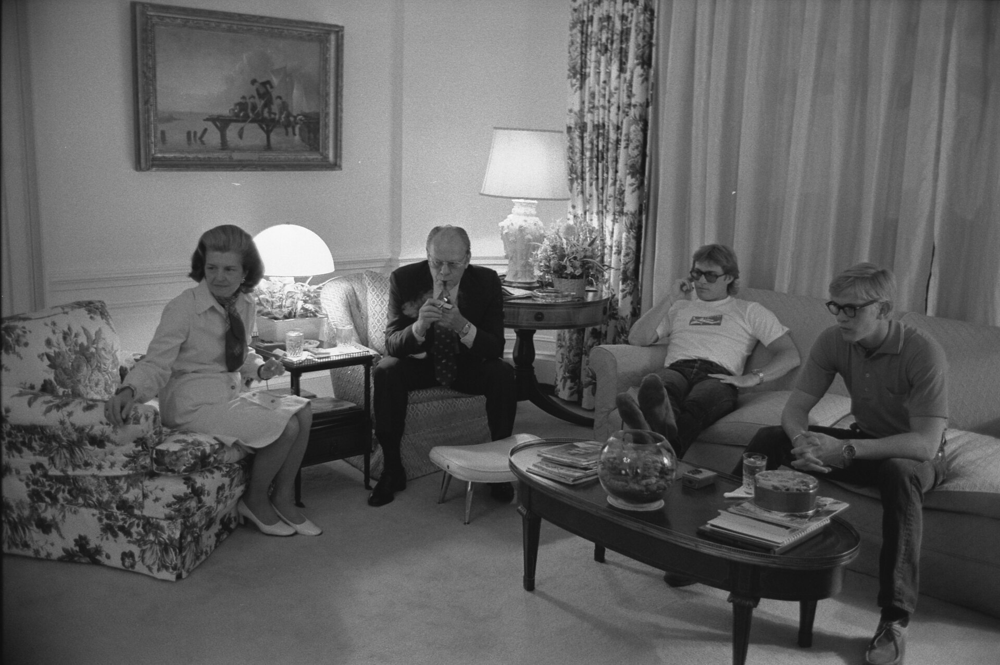
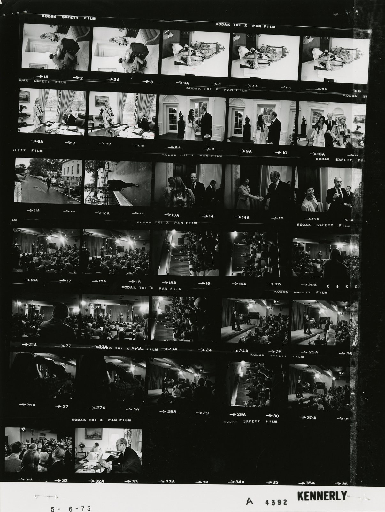

49 years ago today, November 28, 1977, jazz history and audio technology met in a landmark recording session. Acclaimed saxophonist Archie Shepp recorded his album "On Green Dolphin Street," which earned distinction as the first digitally recorded album to be released commercially in the United States. It was an unexpected meeting between modern digital sound and a classic American standard.

## An Avant-Garde Pioneer at the Controls

Born in Fort Lauderdale, Florida, and raised in Philadelphia, Archie Vernon Shepp had studied drama at Goddard College before emerging as a major voice in creative music. In the early 1960s, he performed with Cecil Taylor and Bill Dixon, eventually drawing the attention of John Coltrane. Coltrane's mentorship helped Shepp secure recording sessions with Impulse! Records, starting with Four for Trane in 1964 and the celebrated collaborative album Ascension in 1965.

Throughout the late 1960s and 1970s, Shepp pushed boundaries both aesthetically and socially. Works such as Fire Music, featuring an elegy for Malcolm X, and The Magic of Ju-Ju drew deeply on African musical roots and percussion. Later projects like Attica Blues directly addressed civil rights struggles, cementing Shepp's reputation as a daring innovator who took jazz into fearless creative territory.

## The Storied Path of Green Dolphin Street

The title track Shepp tackled on that November day carried its own rich history. Composed in 1947 by Bronisław Kaper with lyrics by Ned Washington, "On Green Dolphin Street" was originally composed for a film starring Lana Turner and Van Heflin, adapted from a novel by Elizabeth Goudge. Jazz critic Ted Gioia later pointed out that jazz musicians embraced the composition because of its engaging chord changes, which alternate between floating pedal points and rapid harmonic movement.

Pianist Ahmad Jamal gave the melody new life in 1956 on his album Count 'Em 88, utilizing dynamics and space in a style that soon influenced Miles Davis. In 1958, Davis recorded a sextet version featuring John Coltrane, Cannonball Adderley, and Bill Evans, establishing the track as a core jazz standard. Over subsequent decades, the song accumulated more than 700 recorded renditions across vocal and instrumental styles.

*Scene of the era (not a photo of this event) — Photo: David Hume Kennerly / Public domain*

## The Leap into Digital Recording

When Shepp entered the studio on November 28, 1977, recording technology stood on the verge of a major transformation. For decades, commercial albums had relied entirely on analog magnetic tape. Digital recording introduced a method of encoding sound into binary data, offering unprecedented clarity and eliminating the generational noise inherent to tape duplication.

Shepp's session for "On Green Dolphin Street" captured this technological leap, resulting in the first digitally recorded album to be released commercially in the United States. Pairing an avant-garde saxophonist known for raw, expressive power with state-of-the-art digital audio equipment made the project an exceptional technical milestone.

*Scene of the era (not a photo of this event) — Photo: David Hume Kennerly / Public domain*

## Jazz as an Ever-Evolving Art Form

From its early 20th-century origins in the African-American communities of New Orleans, jazz has consistently reinvented itself through changing times. Emerging from blues, ragtime, spirituals, and brass band traditions, it moved from 1930s swing big bands to the complex tempos of bebop in the 1940s, cool jazz, hard bop, modal jazz, and free jazz through the 1950s and 1960s.

As jazz incorporated electric instruments and fusion in the 1970s, Shepp's digital session demonstrated that acoustic jazz standards could also embrace the frontier of audio science. The music proved once again that jazz remained open to technical exploration without losing its expressive core.

*Scene of the era (not a photo of this event) — Photo: David Hume Kennerly / Public domain*

## A Quiet Milestone Remembered

While digital recording would soon become standard across the entire recording industry during the compact disc era, Archie Shepp's 1977 recording remains an important historical marker. It showed that technology could serve timeless improvisation, preserving an iconic standard with pristine precision.

Today, November 28, 1977, stands as the date when American commercial record shelves first opened their doors to digital sound, guided by the tenor saxophone of Archie Shepp.

### Sources

- <https://en.wikipedia.org/wiki/Jazz>
- <https://commons.wikimedia.org/wiki/File:Swing-Journal-1966-September-1.jpg>
- <https://commons.wikimedia.org/wiki/File:Ford_B2175_NLGRF_photo_contact_sheet_(1976-11-02)(Gerald_Ford_Library).jpg>
- <https://commons.wikimedia.org/wiki/File:Ford_family_watches_Sacramento_assassination_attempt_news_coverage_image_A6332-04.jpg>
- <https://commons.wikimedia.org/wiki/File:Ford_A4392_NLGRF_photo_contact_sheet_(1975-05-06)(Gerald_Ford_Library).jpg>
