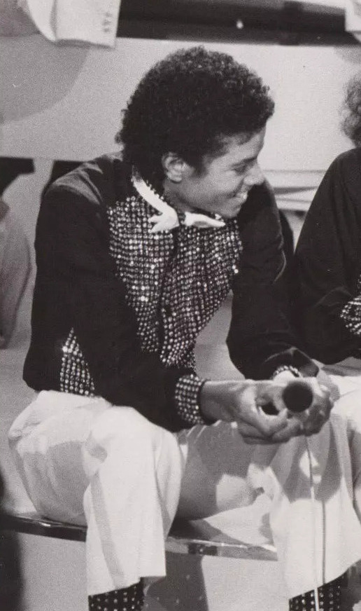
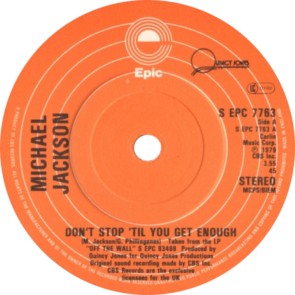
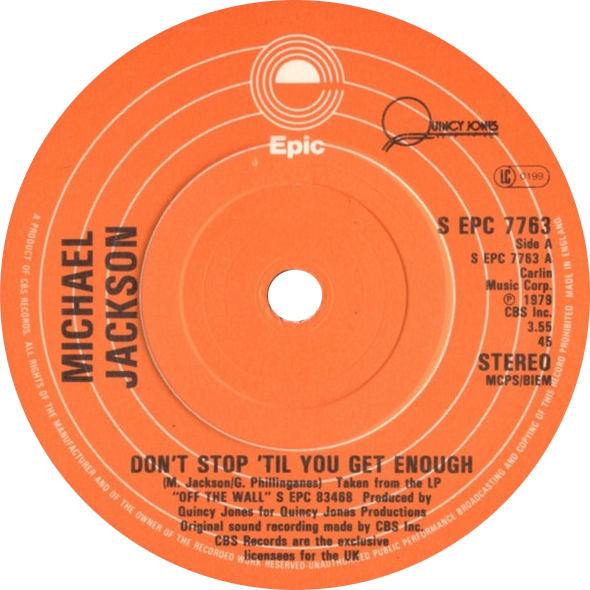

44 years ago today, November 29, 1982, Epic Records officially released Michael Jackson's sixth solo studio album, Thriller. It arrived in record bins on vinyl LPs and cassette tapes, carrying nine tracks that would fundamentally reshape modern popular music and shatter global commercial sales records.

## Frustration and Ambition After Off the Wall

Before Thriller, Michael Jackson had already established himself as a solo powerhouse with his 1979 album Off the Wall. Produced by Quincy Jones, that release achieved critical acclaim and went on to sell seven million copies. Despite this success, Jackson felt deeply unfulfilled and undervalued by the broader music industry.

He was particularly disappointed that Off the Wall did not earn the Grammy Award for Album of the Year. Jackson also felt the sting of racial barriers across American media; in 1980, when Rolling Stone magazine declined to feature him on its cover, Jackson remarked that he was repeatedly told Black faces did not move magazines. He declared that one day publications would be begging him for interviews. When he turned 21 in August 1979, Jackson hired attorney John Branca as his manager and stated openly that he intended to become the biggest and wealthiest entertainer in show business. Heading into his next project, he set an uncompromising standard: every song on the album had to be a killer.

## Crafting the Album at Westlake Studios

Recording sessions began in April 1982 and ran through November at Westlake Recording Studios in Los Angeles, California. Working alongside Quincy Jones, Jackson operated with a production budget of 750,000 dollars. At a time when disco was suffering a widespread cultural backlash, Jackson chose to pivot into a new sonic territory.

The resulting tracks drew heavily from post-disco, synth-pop, funk, and rock. Jackson explored lyrical themes ranging from romance and social consciousness to intense paranoia. To broaden the album's collaborative reach, Paul McCartney joined Jackson in the studio, becoming the first credited featured guest artist on any solo Michael Jackson release.

*Archive, 1981 — Photo: CBS Television / Public domain*

## A Historic Wave of Singles

Upon its release on November 29, 1982, Thriller began an ascent that transformed American radio and retail stores. The album yielded a total of seven singles, every single one of which reached the Top 10 on the Billboard Hot 100 chart: 'The Girl Is Mine', 'Billie Jean', 'Beat It', 'Wanna Be Startin' Somethin'', 'Human Nature', 'P.Y.T. (Pretty Young Thing)', and 'Thriller'.

Both 'Billie Jean' and 'Beat It' climbed all the way to number one on the Billboard Hot 100. This unprecedented run established a music industry record for the most Top 10 hits generated from a single studio album, keeping Jackson constantly on the airwaves throughout 1983 and 1984.

*NOT FROM THE EVENT · 1979 — Photo: Epic Records / Public domain*

## Chart Dominance and Grammy Records

Thriller gave Jackson his very first number-one album on the Billboard Top LPs and Tape chart. Once it claimed the top position, it stayed there for a record-breaking 37 non-consecutive weeks. By early 1984, global shipments crossed 30 million copies, making it the best-selling album in history in less than two years.

Industry recognition followed the massive commercial numbers. At the Grammy Awards, Thriller won a record eight honors in a single ceremony, including Album of the Year and Record of the Year for 'Beat It'. Jackson also collected eight trophies at the American Music Awards. Thriller finished as the best-selling album worldwide in 1983, and in 1984 became the first album ever to lead total US sales for two consecutive calendar years.

*NOT FROM THE EVENT · 1979 — Photo: Epic Records / Public domain*

## Cultural Phenomenon and American Impact

The release sparked a nationwide and international fan frenzy that commentators dubbed Michaelmania. The album's massive crossover appeal broke longstanding racial barriers in American commercial music, propelling Jackson to an unprecedented level of visibility for a Black artist.

Accompanied by landmark music videos that revolutionized the medium into high-budget visual storytelling, Thriller helped redefine the pop performance standard. In 2008, the Library of Congress recognized its enduring importance by inducting the album into the National Recording Registry of culturally, historically, or aesthetically significant recordings, alongside an induction into the Grammy Hall of Fame.

## The Undefeated Record Today

Decades after that late November morning in 1982, Thriller remains firmly in place at the summit of recorded music. With estimated worldwide sales topping 70 million copies and a 34-times platinum certification in the United States, no studio album has ever surpassed its total.

From the opening bass groove of 'Billie Jean' to the hard rock guitar work on 'Beat It', Thriller captured a unique moment when radio formats, retail demand, and visual performance converged. More than four decades later, Michael Jackson's masterpiece remains an enduring benchmark of American pop culture.

### Sources

- <https://en.wikipedia.org/wiki/Michael_Jackson>
- <https://commons.wikimedia.org/wiki/File:Katherine_Jackson,_MJ,_others,_New_York_Amsterdam_News_1977_12_03_pg40.jpg>
- <https://commons.wikimedia.org/wiki/File:Michael_Jackson,_Diana_Ross,_Quincy_Jones,_%22Diana%22_(1981_CBS_press_photo)_(cropped).jpg>
- <https://commons.wikimedia.org/wiki/File:Dont_stop_til_you_get_enough_michael_jackson_UK_7-inch_solid_centre.webp>
- <https://commons.wikimedia.org/wiki/File:Dont_stop_til_you_get_enough_michael_jackson_UK_7-inch_solid_centre.png>
