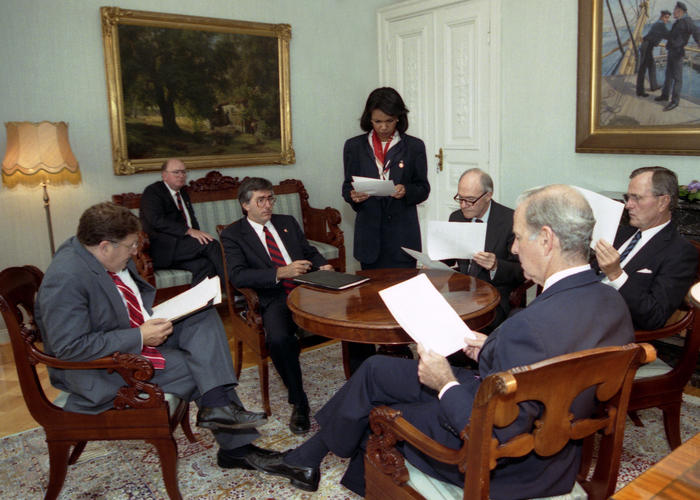
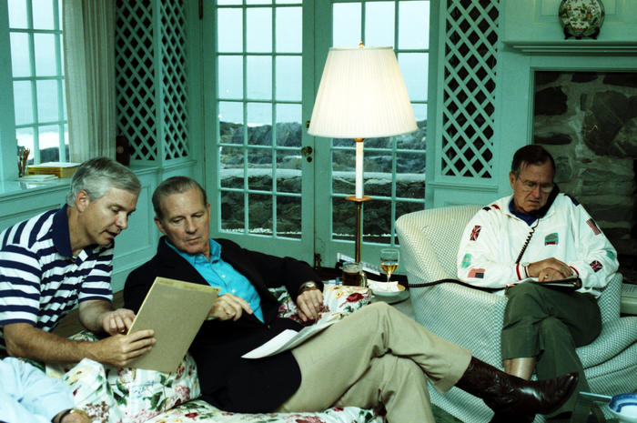
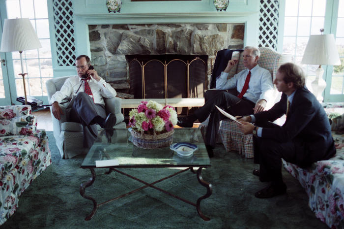

36 years ago today, November 29, 1990, the United Nations Security Council passed Resolution 678, authorizing military intervention against Iraq if its armed forces did not withdraw from Kuwait and release all foreign hostages. It was the decisive legal turning point that paved the way for the Gulf War.

## The Invasion of Kuwait and International Response

On August 2, 1990, Iraqi military forces crossed the border into neighboring Kuwait and occupied the country. The invasion met immediate condemnation from the international community. The United Nations Security Council acted on the very day of the assault, passing resolutions that demanded Iraq withdraw unconditionally to the positions it held on August 1. Four days later, the Security Council imposed a total economic embargo. In response, a massive international military deployment began under Operation Desert Shield, assembling a 42-country coalition led by the United States, alongside major contributors including Saudi Arabia, the United Kingdom, and Egypt.

## The Power of Chapter VII of the UN Charter

The United Nations Security Council holds primary responsibility for international peace and security under the UN Charter. Under Chapter VII, the Council is uniquely empowered to identify threats to peace and authorize enforcement actions, ranging from economic sanctions to the direct use of armed force. Security Council resolutions are the only UN decisions that carry legally binding authority over all member states. Despite ten separate Security Council resolutions passed between August and November 1990, Iraqi forces remained entrenched in Kuwait, refusing to comply with international demands.

*President George H. W. Bush meets with senior staff — Photo: Credit: George H.W. Bush Presidential Library and Museum / Public domain*

## High-Stakes Diplomacy Before the Vote

To secure authorization for armed intervention, the United States engaged in intense diplomatic lobbying among Council members. China, which traditionally vetoed military interventions against sovereign nations, agreed to abstain after receiving assurances that American economic sanctions would be eased and that China's foreign minister would be received at the White House. To ensure the support of the Soviet Union, Washington secured a commitment from the Saudi Arabian government to provide 1 billion dollars in winter economic aid to Moscow. Other nations were offered economic incentives for affirmative votes, while opposition was discouraged through diplomatic and economic pressure.

*President George H. W. Bush speaks to King Fahd of Saudi Arabia via telephone — Photo: Credit: George H.W. Bush Presidential Library and Museum / Public domain*

## The Vote on Resolution 678

On November 29, 1990, the Security Council convened under the co-sponsorship of Canada, the Soviet Union, the United Kingdom, and the United States. Resolution 678 offered Iraq one final opportunity to implement Resolution 660. The measure authorized member states to use 'all necessary means' to uphold previous decisions and restore peace if Iraq did not withdraw by January 15, 1991. The resolution passed with 12 votes in favor, one abstention from China, and two votes against, cast by Cuba and Yemen. Following Yemen's dissenting vote, American officials warned that it was 'the most expensive no vote you ever cast.' The United States promptly ceased more than 70 million dollars in bilateral foreign assistance to Yemen, while World Bank and International Monetary Fund programs were halted and Yemeni workers were expelled from Saudi Arabia.

*President George H. W. Bush speaks to Egyptian President Hosni Mubarak via telephone — Photo: Credit: George H.W. Bush Presidential Library and Museum / Public domain*

## From Deadline to Operation Desert Storm

The January 15, 1991 deadline came and went without an Iraqi withdrawal. Two days later, on January 17, 1991, the coalition launched Operation Desert Storm, beginning with an intense five-week aerial and naval bombardment. The campaign highlighted advanced military technologies, including F-117 Nighthawk stealth aircraft, satellite guidance, and precision-guided munitions, while live television reporting from Baghdad captivated audiences around the world. On February 24, coalition ground forces entered Kuwait and southern Iraq, achieving a decisive victory and declaring a ceasefire within 100 hours. Resolution 678 stands in history as the pivotal mandate that transformed diplomatic stalemate into unified global military action.

### Sources

- <https://en.wikipedia.org/wiki/United_Nations_Security_Council>
- <https://commons.wikimedia.org/wiki/File:President_George_H._W._Bush_meets_with_Prime_Minister_Margaret_Thatcher_and_NATO_Secretary_General_Manfred_Woerner_in_the_Oval_Office.jpg>
- <https://commons.wikimedia.org/wiki/File:President_George_H._W._Bush_meets_with_senior_staff.jpg>
- <https://commons.wikimedia.org/wiki/File:President_George_H._W._Bush_speaks_to_King_Fahd_of_Saudi_Arabia_via_telephone.jpg>
- <https://commons.wikimedia.org/wiki/File:President_George_H._W._Bush_speaks_to_Egyptian_President_Hosni_Mubarak_via_telephone.jpg>
