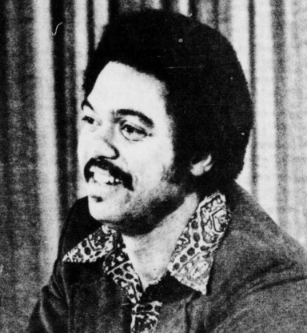
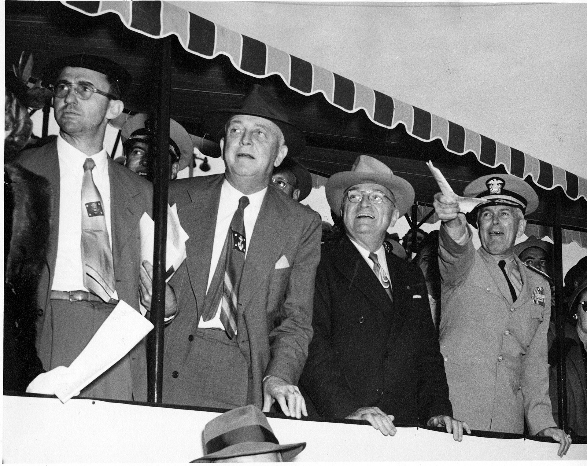
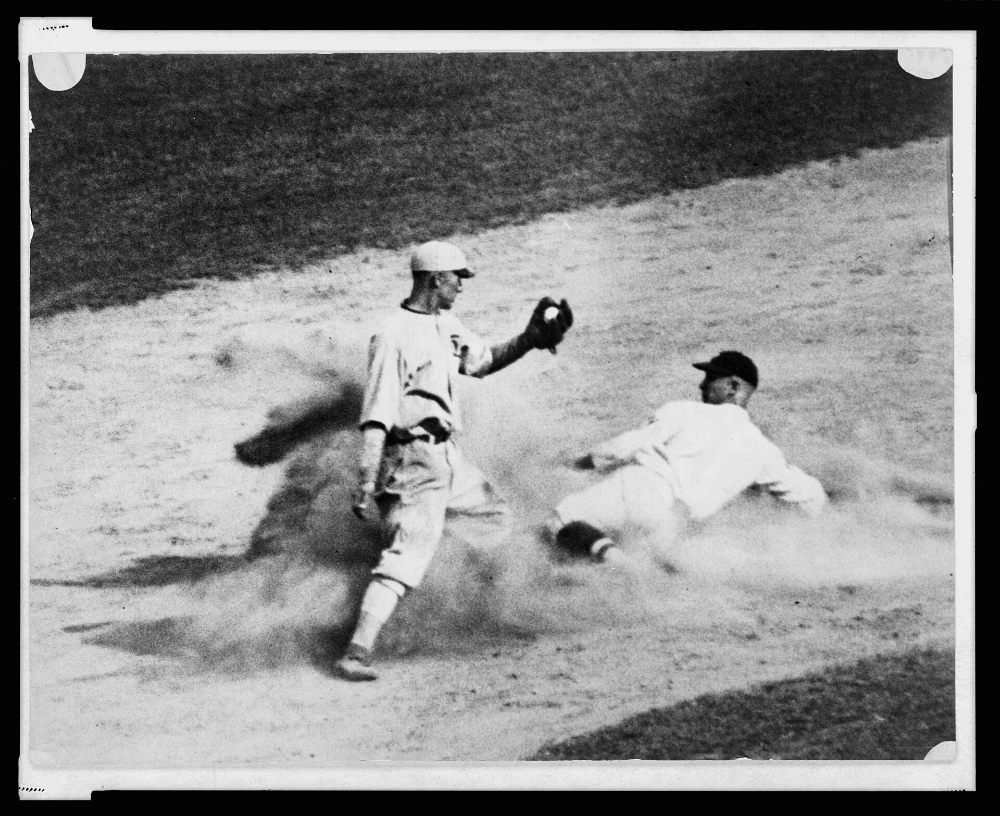

Fifty years ago today, on November 29, 1976, the New York Yankees signed free agent outfielder Reggie Jackson to a historic five-year, 3 million dollar contract. The landmark agreement shocked the sports world and established an enduring precedent for lucrative, multi-year contracts across Major League Baseball.

## The Birth of Baseball Free Agency

Before the mid-1970s, major league ballplayers were largely bound to their original teams by baseball's reserve clause, leaving them with little leverage to test the open market. That changed dramatically as the legal foundations of player movement evolved, giving rise to modern free agency. Team owner George Steinbrenner, who had purchased the Yankees from CBS in 1973, saw an immediate opportunity to return the Bronx franchise to championship glory. When the 1976 season concluded, Steinbrenner set his sights on the most dynamic and charismatic power hitter available.

## A Proven Champion Arrives in the Bronx

Born Reginald Martinez Jackson in Pennsylvania in 1946, the athletic right fielder had already built a Hall of Fame resume before ever putting on pinstripes. Jackson's father had played second base in Negro league baseball, and Jackson quickly rose through professional ranks after high school and college. Playing for the Kansas City and Oakland Athletics, Jackson helped Oakland capture five consecutive American League West division titles from 1971 to 1975, along with three consecutive World Series championships from 1972 through 1974. In 1973, he captured the American League Most Valuable Player award after leading the league in home runs and runs batted in. After a brief one-season stop with the Baltimore Orioles in 1976, Jackson entered the open market as the premier prize in sports.

*Reggie Jackson 1973 — Photo: United Press International / Public domain*

## The 3 Million Dollar Shockwave

When the Yankees officially announced the signing on November 29, 1976, the numbers sounded staggering to fans and team owners alike: five years and roughly 3 million dollars. At the time, guaranteed multi-year contracts of that magnitude were virtually unprecedented in professional team sports. Critics questioned whether any individual player could justify such an enormous financial commitment, while rival owners feared the deal would trigger an uncontrollable escalation in salaries. Steinbrenner was unbothered, firmly believing that Jackson possessed the star power and clutch performance needed to bring New York its first championship in over a decade.

*President Harry S. Truman and Others at Army-Navy Baseball Game — Photo: Series: Photographs Relating to the Administration, Family,  / Public domain*

## Becoming 'Mr. October' in the 1977 World Series

Jackson wasted little time validating the Yankees' massive investment. Although his first season in the Bronx brought intense media scrutiny and high-profile team drama, Jackson shined brightest when the postseason arrived, earning the enduring moniker 'Mr. October.' During the 1977 World Series against the Los Angeles Dodgers, Jackson produced one of the most iconic individual feats in baseball history. In Game 6 at Yankee Stadium, Jackson blasted three consecutive home runs on three consecutive pitches from three different pitchers, securing the title for New York and taking home the World Series MVP and Babe Ruth awards.

*Ball player sliding into base as fielder reaches to apply tag during baseball game LCCN2005676972 — Photo: National Photo Company Collection / Public domain*

## A Lasting Dynasty and Hall of Fame Legacy

The success continued in 1978 as Jackson helped lead the Yankees to a second consecutive World Series crown, marking four American League East titles and three AL pennants during his tenure in the Bronx. Over his 21 seasons in the majors—spanning Oakland, Baltimore, New York, and later the California Angels—Jackson compiled 563 career home runs and was selected to 14 All-Star games. In 1993, Jackson was elected to the National Baseball Hall of Fame in his very first year of eligibility, and his uniform number was retired by both the Yankees and the Athletics.

## The Precedent That Changed Professional Sports

Looking back 50 years later, Reggie Jackson's 1976 signing stands as the dividing line between baseball's past and its modern economic era. The five-year, 3 million dollar deal proved that marquee free agents could generate enormous financial and athletic returns for their clubs. Today, player contracts routinely exceed hundreds of millions of dollars, yet every major free agent signing traces its roots directly to that brisk November morning in 1976 when the Yankees brought Mr. October to New York.

### Sources

- <https://en.wikipedia.org/wiki/New_York_Yankees>
- <https://commons.wikimedia.org/wiki/File:Reggie_Jackson_October_1973.jpeg>
- <https://commons.wikimedia.org/wiki/File:Reggie_Jackson_1973.jpeg>
- <https://commons.wikimedia.org/wiki/File:President_Harry_S._Truman_and_Others_at_Army-Navy_Baseball_Game.jpg>
- <https://commons.wikimedia.org/wiki/File:Ball_player_sliding_into_base_as_fielder_reaches_to_apply_tag_during_baseball_game_LCCN2005676972.jpg>
