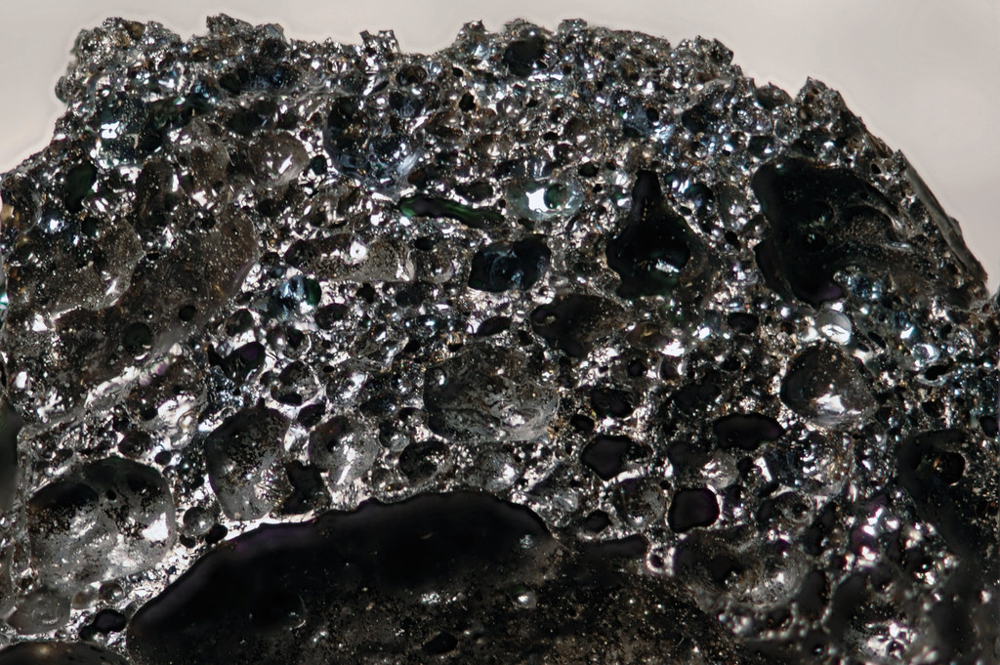
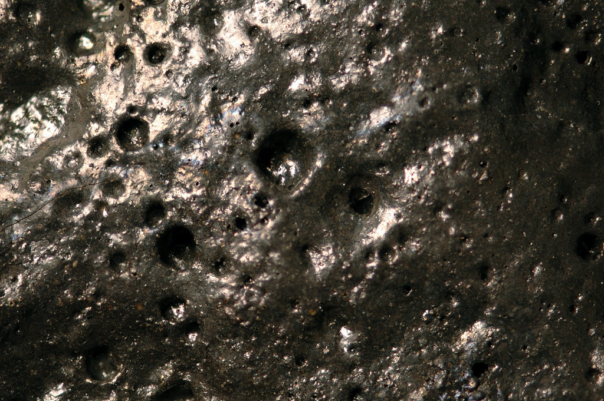

51 years ago today, November 29, 1975, a sudden and violent earthquake struck the Hawaiian Islands. Registering a moment magnitude of 7.7 and reaching a maximum Mercalli intensity of VIII (Severe), the tremor rattled communities across several islands, triggered volcanic activity, and unleashed a deadly local tsunami that forever reshaped the coastline.

## The Geological Force Beneath the Surface

Earthquakes occur when stored elastic strain energy within rock overcomes frictional resistance along geological faults. In Hawaii, this strain was centered around the Hilina Slump, a massive and unstable structural feature situated along the southern flank of Kilauea volcano. The very same fault system was responsible for the catastrophic 1868 earthquake and tsunami. Over decades, gradual tectonic and volcanic movements locked the fault in place, accumulating immense strain until the rock abruptly fractured.

## Violent Shaking Across the Islands

When the rupture occurred, seismic waves radiated outward through the Earth's crust, causing widespread structural disruption. With shaking categorised as Mercalli intensity VIII, the earthquake was strong enough to cause significant structural damage across the southern part of the Big Island. Homes, roads, and utilities sustained heavy impacts, resulting in total damage estimated between $4 million and $4.1 million. The seismic energy also disturbed the magma system within Kilauea, sparking a brief, small volcanic eruption.

*Sideromelane (basaltic lava flow surface of 1969 to 1974 lava tube ceiling, Mauna Ulu Lava Field, East Rift Zone, Kilauea Volcano, Hawaii, USA) 1 — Photo: James St. John / CC BY 2.0*

## A Coastline Submerged in Seconds

The mechanical failure along the Hilina Slump did not just shake the land—it displaced it vertically. Severe subsidence occurred along the southern coastline of the Big Island, with ground levels dropping by up to 12 feet (3.7 meters). This rapid geological collapse altered the geography of the island permanently, submerging coastal land under the Pacific Ocean where dry ground had stood moments earlier.

*Vesiculated tachylite (basaltic lava flow cross-section, 1969 to 1974 lava tube ceiling, Mauna Ulu Lava Field, East Rift Zone, Kilauea Volcano, Hawaii, USA) 1 — Photo: James St. John / CC BY 2.0*

## The Forty-Seven-Foot Wall of Water

The massive vertical displacement of the seafloor immediately displaced the ocean water above it, generating a destructive local tsunami. Waves reached an astonishing height of up to 47 feet (14 meters) along the shores of Hawaii Island. Coastal campsites and low-lying areas were overwhelmed by the sudden wall of water. The catastrophe claimed the lives of two people and left up to 28 others injured as the waves swept through coastal terrain.

*Tachylite (interior roof of 1969 to 1974 lava tube ceiling, Mauna Ulu Lava Field, East Rift Zone, Kilauea Volcano, Hawaii, USA) 2 — Photo: James St. John / CC BY 2.0*

## Pacific-Wide Reverberations

While the most catastrophic damage occurred within minutes along the Big Island's immediate coast, the energy traveled across the entire ocean basin. Tsunami detection stations recorded sea-level disturbances thousands of miles away, including coastal areas in California, Alaska, Samoa, Okinawa, mainland Japan, and Johnston and Wake Islands. The event proved that localized slumps and volcanic flank movements could generate ocean-crossing waves capable of reaching global observation networks.

## Enduring Lessons of the 1975 Disaster

Decades later, the physical marks left by the 1975 earthquake remain embedded in Hawaii's landscape, where submerged coastlines continue to rest underwater. The event became a foundational case study for geologists studying flank stability, tsunami generation, and earthquake engineering. It demonstrated that even in regions celebrated for tropical tranquility, the underlying Earth can shift in an instant, forever changing the boundary between land and sea.

### Sources

- <https://en.wikipedia.org/wiki/Modified_Mercalli_intensity_scale>
- <https://commons.wikimedia.org/wiki/File:DEVELOPERS_SIGN,_EVIDENCE_OF_LAND_SPECULATION_IN_PUNA_AREA_NEAR_KALAPANA._VOLCANIC_SOIL_AND_ARID_CONDITIONS_INHIBIT..._-_NARA_-_554123.jpg>
- <https://www.flickr.com/photos/47445767@N05/14838868090>
- <https://www.flickr.com/photos/47445767@N05/15025522485>
- <https://www.flickr.com/photos/47445767@N05/14838869050>
