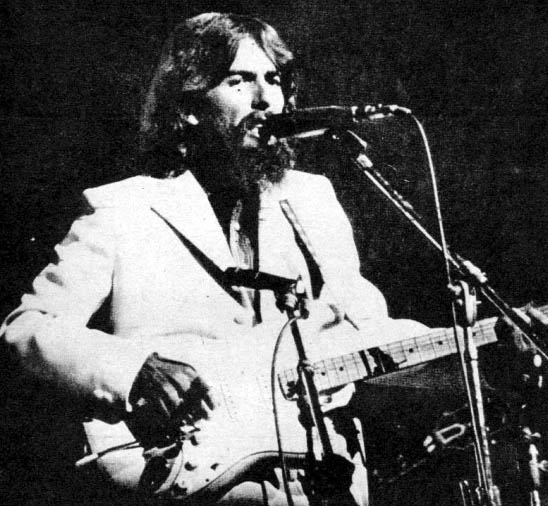
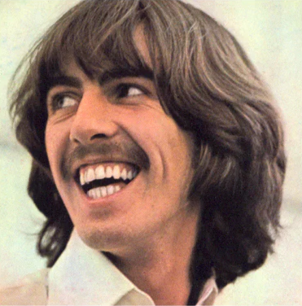
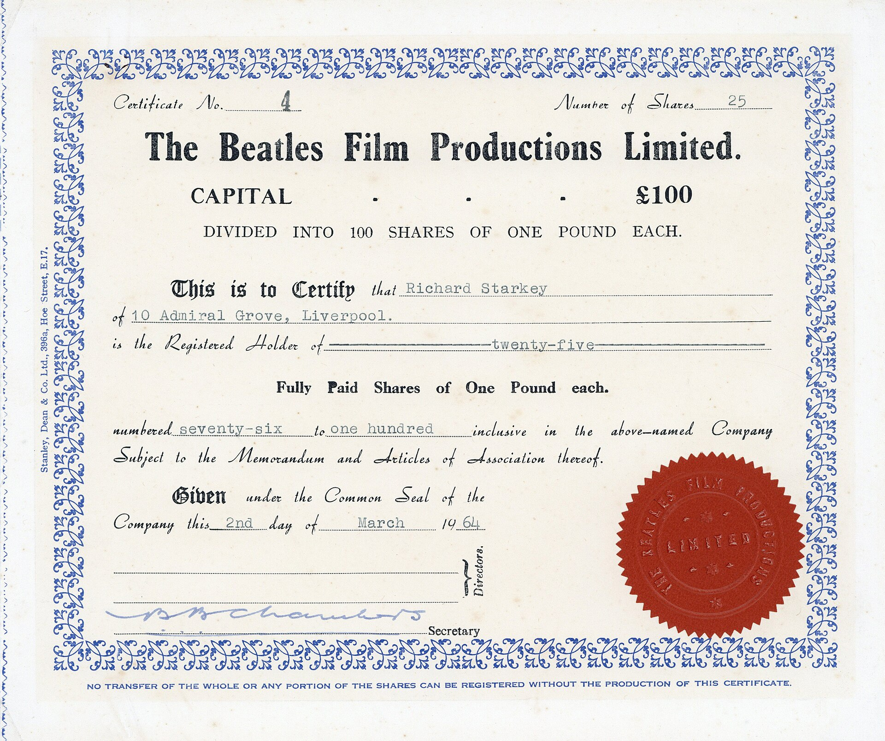

25 years ago today, November 29, 2001, George Harrison passed away from lung cancer in Los Angeles at the age of 58. As the lead guitarist of the Beatles, Harrison had shared in unprecedented global fame, yet he spent his life cultivating a gentle musical and spiritual path that set him apart. His death marked the loss of a second member of the Fab Four, leaving music lovers around the globe in deep mourning.

## An Audition on the Top Deck of a Liverpool Bus

Born in Liverpool in February 1943, Harrison was the youngest of four children in a working-class household. His mother was a music enthusiast who encouraged his passion for the guitar. In early 1958, when Harrison was only 15, his schoolmate Paul McCartney introduced him to John Lennon, who led a skiffle band called the Quarrymen. Lennon initially hesitated to welcome someone so young into the group. Persistent and determined, Harrison arranged a second audition, climbing to the upper deck of a Liverpool double-decker bus to perform the guitar instrumental 'Raunchy.' Lennon was thoroughly impressed by his technical skill, and Harrison was immediately enlisted as lead guitarist.

## Finding a Voice Within the Fab Four

Through grueling residencies in Hamburg and the Cavern Club in Liverpool, the group honed their chops, eventually adding drummer Ringo Starr in 1962. When the Beatles conquered the United States and launched the British Invasion in 1964, Harrison was affectionately labeled 'the quiet Beatle' by the media. Although John Lennon and Paul McCartney served as the primary songwriting partnership, Harrison steadily carved out his own creative territory. Most Beatles albums featured at least one of his compositions, and he began steering the group toward new sounds, incorporating folk-rock influences from Bob Dylan and the Byrds.

*George harrison en 1973 — Photo: Unknown authorUnknown author / Public domain*

## Bringing the Sitar and Eastern Influences to the World

Harrison's curiosity pushed popular music into uncharted territory. In 1965, after encountering Indian classical instruments on the set of the film 'Help!', Harrison began studying the sitar. He famously played the instrument on 'Norwegian Wood (This Bird Has Flown),' marking one of the earliest integrations of Indian classical instrumentation into mainstream Western rock. Harrison's spiritual exploration also inspired the Beatles to embrace Transcendental Meditation in 1967. By the end of the band's studio years, Harrison was contributing some of the Beatles' most enduring classics, including 'Taxman,' 'While My Guitar Gently Weeps,' 'Here Comes the Sun,' and 'Something.'

*George Harrison in Let It Be — Photo: Apple Records / Public domain*

## Solo Triumphs and the First Charity Rock Concert

Following the break-up of the Beatles in 1970, Harrison unleashed an enormous backlog of original material. He released the acclaimed triple album 'All Things Must Pass,' which established his signature slide guitar style and produced the worldwide chart-topper 'My Sweet Lord.' In August 1971, Harrison teamed up with Indian master musician Ravi Shankar to organize the Concert for Bangladesh in New York, raising funds and global awareness for refugees. The historic event became the pioneering blueprint for future philanthropic rock concerts, including Live Aid. Harrison later founded Dark Horse Records and co-founded HandMade Films to produce Monty Python's 'Life of Brian.'

*Beatles Film Production 1964 — Photo: Julie Ceccaldi / CC0*

## The Traveling Wilburys and Enduring Acclaim

Harrison continued to find joy in collaborative music-making. In 1988, he co-founded the platinum-selling supergroup the Traveling Wilburys alongside Bob Dylan, Tom Petty, Roy Orbison, and Jeff Lynne. That same year, Harrison was inducted into the Rock and Roll Hall of Fame alongside his Beatles bandmates. Rolling Stone would later rank him among the greatest guitarists of all time. After Harrison's death in 2001, he received a second, posthumous induction into the Rock and Roll Hall of Fame in 2004 for his solo achievements, cementing his place in music history.

## A Legacy That Still Shines

A lifelong smoker, Harrison faced a difficult battle with cancer during his final years before passing away quietly in Los Angeles on November 29, 2001. Following John Lennon's tragic murder in 1980, Harrison's death left Paul McCartney and Ringo Starr as the remaining active members carrying forward the Beatles' torch. Yet, a quarter-century after his departure, Harrison's presence remains as bright as ever. From the optimistic opening acoustic chords of 'Here Comes the Sun' to his pioneering humanitarian efforts, the quiet Beatle continues to offer solace, beauty, and peace to listeners across the world.

### Sources

- <https://en.wikipedia.org/wiki/The_Beatles>
- <https://commons.wikimedia.org/wiki/File:George_Harrison_-_Ding_Dong_(cropped).png>
- <https://commons.wikimedia.org/wiki/File:George_harrison_en_1973.jpg>
- <https://commons.wikimedia.org/wiki/File:George_Harrison_in_Let_It_Be.png>
- <https://commons.wikimedia.org/wiki/File:Beatles_Film_Production_1964.jpg>
