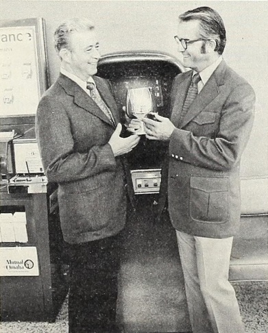
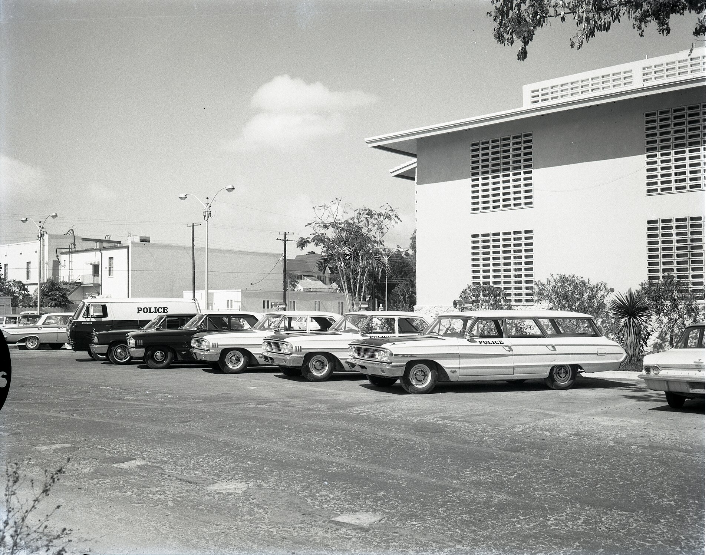
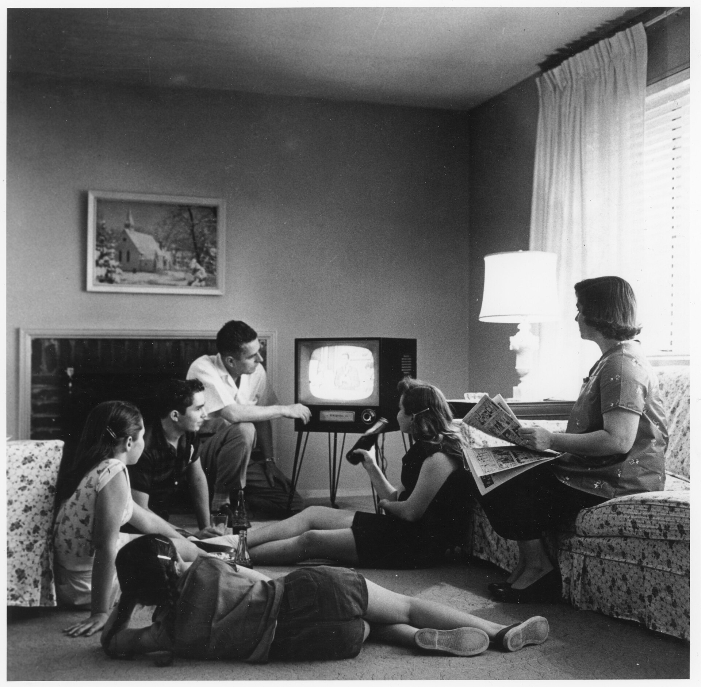

54 years ago today, November 29, 1972. In California, a young startup called Atari released the arcade version of Pong, marking the arrival of the very first commercially successful video game in history. At a time when computers were massive machines locked away in research universities, this simple electronic table tennis game brought digital entertainment straight to local bars and bowling alleys.

## From University Arcades to Silicon Valley

The story of Pong began with Nolan Bushnell while he was studying electrical engineering at the University of Utah. During college, Bushnell worked part-time at an amusement arcade. Watching customers feed coins into electro-mechanical games and helping maintain the machinery gave him a clear understanding of the coin-operated amusement business.

After graduating in 1968, Bushnell moved to California to work as an engineer at Ampex in San Francisco. There, he met Ted Dabney. The two bonded over their mutual fascination with technology and gaming. Bushnell took Dabney to the Stanford Artificial Intelligence Laboratory to see games running on mainframe computers. Together, they developed the ambitious concept of building a standalone computer monitor unit fitted with a coin slot.

## The Failure of Computer Space

In 1971, Bushnell and Dabney launched a partnership called Syzygy Engineering, funding it with 250 dollars each out of their own pockets. They partnered with Nutting Associates to manufacture their very first commercial project: Computer Space, a space combat game inspired by the earlier mainframe program Spacewar!.

Nutting manufactured roughly 1,500 Computer Space cabinets and placed them into bars, but the game struggled commercially. Players found the controls intimidating and confusing. They had to stop and read printed instructions on the cabinet before inserting a coin. Bushnell realized that for coin-operated electronic machines to succeed with everyday patrons, the design had to change completely. He noted that he needed a game so simple that anyone at a bar could play immediately without instructions.

*Super Spaceman Award — Photo: Unknown authorUnknown author / Public domain*

## A 250-Dollar Start and a New Name

Bushnell and Dabney decided to branch out on their own. They approached pinball manufacturer Bally Manufacturing, which agreed to fund their work with 4,000 dollars a month for six months to design a video game and a pinball machine. With those funds in hand, the partners set up an office in Santa Clara, California, and hired their first design engineer, former Ampex colleague Al Alcorn.

When Bushnell and Dabney attempted to officially incorporate their company, they discovered that another California business was already using the name Syzygy. Bushnell, an avid player of the strategy board game Go, looked to terms from the game. He chose the word 'atari', a Japanese Go term that signals a piece is under immediate threat of capture. In 1972, Atari, Inc. was born in Sunnyvale, California.

*Scene of the era (not a photo of this event) — Photo: Florida Keys--Public Libraries / CC BY 2.0*

## How Al Alcorn Built Pong

In May 1972, Bushnell attended a demonstration of the Magnavox Odyssey, an early home video console that included an electronic tennis game. Bushnell decided to have Al Alcorn design an arcade tennis game using Ted Dabney's cost-effective video circuit designs, which replaced expensive general-purpose computers with dedicated electronic circuitry.

Bushnell initially framed the project as an introductory exercise for Alcorn. However, Alcorn's engineering work exceeded expectations. The screen displayed two vertical paddles controlled by rotary knobs, a dashed center line, a bouncing electronic dot representing the ball, and digital score counters at the top. The rules were instantly understood by anyone who had ever seen table tennis: twist the dial, hit the ball, and do not miss.

*Scene of the era (not a photo of this event) — Photo: Evert F. Baumgardner / Public domain*

## The Birth of the Modern Arcade

When Atari officially released the finished arcade version of Pong on November 29, 1972, the response was immediate. Players lined up to drop quarters into the machine. Unlike earlier electro-mechanical novelties or overly complicated space simulations, Pong offered pure head-to-head competition that required zero prior training.

Pong quickly proved to be a massive commercial triumph, providing Atari with the capital and momentum to expand across Silicon Valley. It proved that electronic entertainment could be profitable, reliable, and wildly popular with the general public, effectively creating the commercial video arcade industry from scratch.

## The Legacy That Followed

The triumph of Pong set off a technological revolution. By 1975, Atari expanded into living rooms with dedicated home console versions of Pong, followed by the groundbreaking Atari Video Computer System, later known as the Atari 2600, in 1977. Arcade hits like Asteroids and the home conversion of Space Invaders soon followed, inaugurating the golden age of video games.

Today, video games represent a worldwide market worth hundreds of billions of dollars, larger than the traditional film and recorded music industries combined. Yet every modern console, computer title, and mobile game can trace its commercial lineage back to that humble wooden cabinet and two electronic paddles introduced 54 years ago today.

### Sources

- <https://en.wikipedia.org/wiki/November%2029>
- <https://commons.wikimedia.org/wiki/File:Computer_Space_final_tests.png>
- <https://commons.wikimedia.org/wiki/File:Super_Spaceman_Award.jpg>
- <https://commons.wikimedia.org/wiki/File:Police_Cars_at_City_Hall_Key_West_Florida_1965.jpg>
- <https://commons.wikimedia.org/wiki/File:Family_watching_television_1958.jpg>
